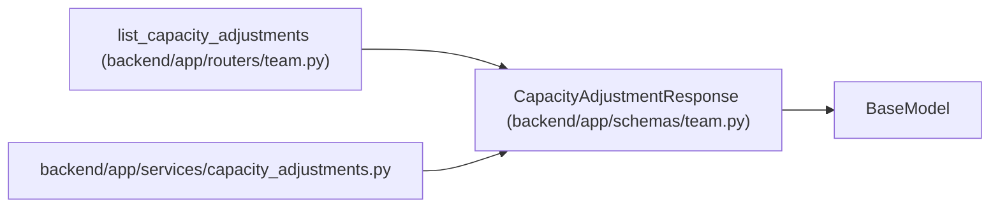

# CapacityAdjustmentResponse

**Location:** `backend/app/schemas/team.py:443`
**Kind:** Pydantic model
**Bases:** `BaseModel`
**Module:** [schemas_team](../modules/schemas_team.md)

## Description

A recorded or withdrawn dated adjustment, with who recorded it.

## Model Configuration

| Setting | Value | Source |
|---------|-------|--------|
| `from_attributes` | `True` | model_config |

## Attributes

| Name | Type | Wire name | Required | Nullable | Default | Constraints | Examples | Description |
|------|------|-----------|----------|----------|---------|-------------|-------------|----------|
| `id` | `Optional[int]` | `id` | No | Yes | `None` | — | — | — |
| `team_member_id` | `int` | `team_member_id` | Yes | No | — | — | — | — |
| `start_date` | `date` | `start_date` | Yes | No | — | — | — | — |
| `end_date` | `date` | `end_date` | Yes | No | — | — | — | — |
| `availability_percent` | `float` | `availability_percent` | Yes | No | — | — | — | — |
| `base_availability_percent` | `float` | `base_availability_percent` | Yes | No | — | — | — | — |
| `reason` | `str` | `reason` | Yes | No | — | — | — | — |
| `group_token` | `Optional[str]` | `group_token` | No | Yes | `None` | — | — | — |
| `created_by_principal_id` | `Optional[int]` | `created_by_principal_id` | No | Yes | `None` | — | — | — |
| `created_at` | `Optional[datetime]` | `created_at` | No | Yes | `None` | — | — | — |
| `withdrawn_at` | `Optional[datetime]` | `withdrawn_at` | No | Yes | `None` | — | — | — |
| `withdrawn_by_principal_id` | `Optional[int]` | `withdrawn_by_principal_id` | No | Yes | `None` | — | — | — |
| `withdrawal_reason` | `Optional[str]` | `withdrawal_reason` | No | Yes | `None` | — | — | — |
| `withdrawn_group_token` | `Optional[str]` | `withdrawn_group_token` | No | Yes | `None` | — | — | — |
| `active` | `bool` | `active` | No | No | `True` | — | — | — |

## Methods

*No declared methods.*

## Relationships

<!-- Auto-generated relationship summary. Do not edit by hand. -->

### Summary

| Module | Methods | Attributes |
|---|---:|---|
| [schemas_team](../modules/schemas_team.md) | 0 | `active`, `availability_percent`, `base_availability_percent`, `created_at`, `created_by_principal_id`, `end_date`, `group_token`, `id`, `reason`, `start_date`, `team_member_id`, `withdrawal_reason` |

### Structure

| Kind | Entity | Module |
|---|---|---|
| Base | `BaseModel` | — |

### References

| Reference | Kind | Source | Call sites |
|---|---|---|---:|
| `list_capacity_adjustments` | type_reference | [routers_team](../modules/routers_team.md) | — |
| `capacity_adjustments` | import | [capacity_adjustments](../modules/capacity_adjustments.md) | — |
