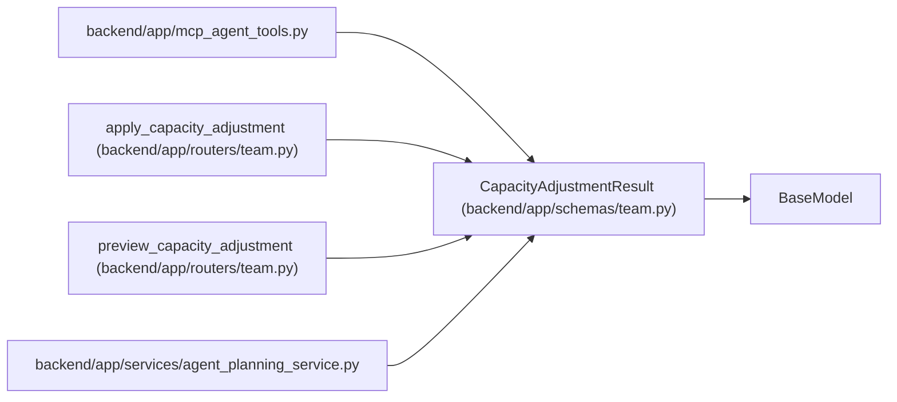

# CapacityAdjustmentResult

**Location:** `backend/app/schemas/team.py:480`
**Kind:** Pydantic model
**Bases:** `BaseModel`
**Module:** [schemas_team](../modules/schemas_team.md)

## Description

Effective capacity for the changed dates and the adjustments the command records.

## Attributes

| Name | Type | Wire name | Required | Nullable | Default | Constraints | Examples | Description |
|------|------|-----------|----------|----------|---------|-------------|-------------|----------|
| `applied` | `bool` | `applied` | Yes | No | — | — | — | — |
| `member_id` | `int` | `member_id` | Yes | No | — | — | — | — |
| `iteration_id` | `int` | `iteration_id` | Yes | No | — | — | — | — |
| `profile_id` | `Optional[int]` | `profile_id` | No | Yes | `None` | — | — | — |
| `group_token` | `Optional[str]` | `group_token` | No | Yes | `None` | — | — | — |
| `created` | `list[CapacityAdjustmentResponse]` | `created` | Yes | No | — | — | — | — |
| `withdrawn` | `list[CapacityAdjustmentResponse]` | `withdrawn` | Yes | No | — | — | — | — |
| `active_adjustments` | `list[CapacityAdjustmentResponse]` | `active_adjustments` | Yes | No | — | — | — | — |
| `reduced_dates` | `list[date]` | `reduced_dates` | Yes | No | — | — | — | — |
| `effective_capacity` | `list[EffectiveCapacityDay]` | `effective_capacity` | Yes | No | — | — | — | — |
| `observed_revisions` | `dict[int, int]` | `observed_revisions` | Yes | No | — | — | — | — |
| `resulting_revisions` | `dict[int, int]` | `resulting_revisions` | No | No | factory: `dict` | — | — | — |
| `planning_revision` | `Optional[int]` | `planning_revision` | No | Yes | `None` | — | — | — |
| `formula` | `str` | `formula` | No | No | `"row hours = person calendar hours after absence × the row's percentage on that date; allocated = the sum of row hours over every row of the same person"` | — | — | — |

## Methods

*No declared methods.*

## Relationships

<!-- Auto-generated relationship summary. Do not edit by hand. -->

### Summary

| Module | Methods | Attributes |
|---|---:|---|
| [schemas_team](../modules/schemas_team.md) | 0 | `active_adjustments`, `applied`, `created`, `effective_capacity`, `formula`, `group_token`, `iteration_id`, `member_id`, `observed_revisions`, `planning_revision`, `profile_id`, `reduced_dates` |

### Structure

| Kind | Entity | Module |
|---|---|---|
| Base | `BaseModel` | — |

### References

| Reference | Kind | Source | Call sites |
|---|---|---|---:|
| `mcp_agent_tools` | import | [mcp_agent_tools](../modules/mcp_agent_tools.md) | — |
| `apply_capacity_adjustment` | type_reference | [routers_team](../modules/routers_team.md) | — |
| `preview_capacity_adjustment` | type_reference | [routers_team](../modules/routers_team.md) | — |
| `agent_planning_service` | import | [agent_planning_service](../modules/agent_planning_service.md) | — |
