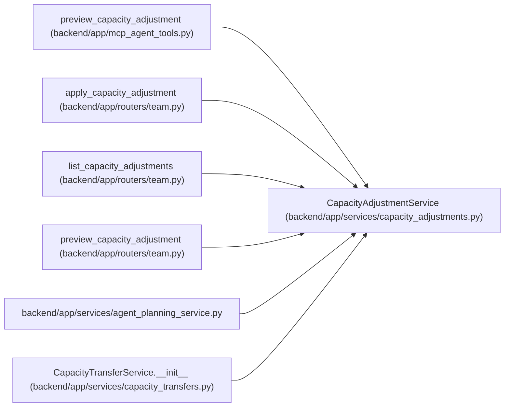

# CapacityAdjustmentService

**Location:** `backend/app/services/capacity_adjustments.py:153`
**Kind:** Class
**Bases:** —
**Module:** [capacity_adjustments](../modules/capacity_adjustments.md)

## Description

Record, withdraw, preview and list dated capacity adjustments.

## Attributes

*No annotated attributes found.*

## Methods

| Method | Signature | Decorators | Description |
|--------|-----------|------------|-------------|
| `__init__` | `(db)` | — | — |
| `_member` | *(async)* `(member_id)` | — | — |
| `list_adjustments` | *(async)* `(member_id, *, include_withdrawn = False)` | — | — |
| `preview` | *(async)* `(member_id, data: CapacityAdjustmentCommand)` | `@preview_command` | Calculate effective capacity with the change, then roll everything back. |
| `apply` | *(async)* `(member_id, data: CapacityAdjustmentCommand, *, commit: bool = True)` | `@schedule_input_command(ADJUSTMENT_KIND)` | Record the change under the observed planning revisions. |
| `_change` | *(async)* `(member_id, data)` | — | — |
| `_refuse_reducing_issued_work` | *(async)* `(member, reduced)` | — | A reduction must not change the capacity that this row's issued work was planned with. |
| `_projection` | *(async)* `(member, start, end)` | — | Return the person's daily totals across all of their rows, or None for a row without a person. |

## Relationships

<!-- Auto-generated relationship summary. Do not edit by hand. -->

### Summary

| Module | Methods | Attributes |
|---|---:|---|
| [capacity_adjustments](../modules/capacity_adjustments.md) | 8 | — |

### References

| Reference | Kind | Source | Call sites |
|---|---|---|---:|
| `preview_capacity_adjustment` | call | [mcp_agent_tools](../modules/mcp_agent_tools.md) | 1 |
| `apply_capacity_adjustment` | call | [routers_team](../modules/routers_team.md) | 1 |
| `list_capacity_adjustments` | call | [routers_team](../modules/routers_team.md) | 1 |
| `preview_capacity_adjustment` | call | [routers_team](../modules/routers_team.md) | 1 |
| `agent_planning_service` | import | [agent_planning_service](../modules/agent_planning_service.md) | — |
| `CapacityTransferService.__init__` | call | [capacity_transfers](../modules/capacity_transfers.md) | 1 |
