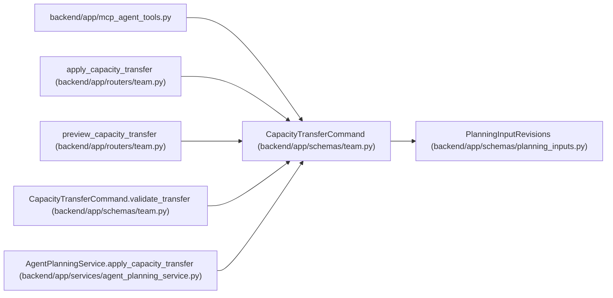

# CapacityTransferCommand

**Location:** `backend/app/schemas/team.py:509`
**Kind:** Class
**Bases:** `PlanningInputRevisions`
**Module:** [schemas_team](../modules/schemas_team.md)

## Description

Lend availability from one or more rows to a row of the same person for a bounded date range.

Each source row counts its own percentage minus ``transferred_percent`` on each
date from ``start_date`` through ``end_date``; the target row counts its own
percentage plus the sum of the lent percentages. Every other date keeps each
row's own percentage, so the shares return after ``end_date`` on their own.

## Validators

| Method | Scope | Fields | Mode | Options |
|--------|-------|--------|------|---------|
| `validate_transfer` | model | — | after | — |

## Attributes

| Name | Type | Wire name | Required | Nullable | Default | Constraints | Examples | Description |
|------|------|-----------|----------|----------|---------|-------------|-------------|----------|
| `target_member_id` | `int` | `target_member_id` | Yes | No | — | ge=1 | — | — |
| `sources` | `list[CapacityTransferSource]` | `sources` | Yes | No | — | min_length=1; max_length=20 | — | — |
| `start_date` | `date` | `start_date` | Yes | No | — | — | — | — |
| `end_date` | `date` | `end_date` | Yes | No | — | — | — | — |
| `reason` | `str` | `reason` | Yes | No | — | min_length=1; max_length=1000 | — | — |

## Methods

| Method | Signature | Decorators | Description |
|--------|-----------|------------|-------------|
| `validate_transfer` | `() -> 'CapacityTransferCommand'` | `@model_validator(mode='after')` | — |

## Relationships

<!-- Auto-generated relationship summary. Do not edit by hand. -->

### Summary

| Module | Methods | Attributes |
|---|---:|---|
| [schemas_team](../modules/schemas_team.md) | 1 | `end_date`, `reason`, `sources`, `start_date`, `target_member_id` |

### Structure

| Kind | Entity | Module |
|---|---|---|
| Base | `PlanningInputRevisions` | [planning_inputs](../modules/planning_inputs.md) |

### References

| Reference | Kind | Source | Call sites |
|---|---|---|---:|
| `mcp_agent_tools` | import | [mcp_agent_tools](../modules/mcp_agent_tools.md) | — |
| `apply_capacity_transfer` | type_reference | [routers_team](../modules/routers_team.md) | — |
| `preview_capacity_transfer` | type_reference | [routers_team](../modules/routers_team.md) | — |
| `CapacityTransferCommand.validate_transfer` | type_reference | [schemas_team](../modules/schemas_team.md) | — |
| `AgentPlanningService.apply_capacity_transfer` | type_reference | [agent_planning_service](../modules/agent_planning_service.md) | — |
