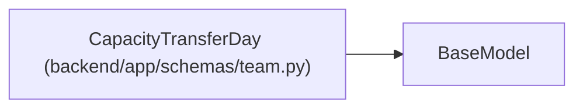

# CapacityTransferDay

**Location:** `backend/app/schemas/team.py:554`
**Kind:** Pydantic model
**Bases:** `BaseModel`
**Module:** [schemas_team](../modules/schemas_team.md)

## Description

One date of one row of a transfer, before and after the command.

## Attributes

| Name | Type | Wire name | Required | Nullable | Default | Constraints | Examples | Description |
|------|------|-----------|----------|----------|---------|-------------|-------------|----------|
| `date` | `date` | `date` | Yes | No | — | — | — | — |
| `availability_percent_before` | `float` | `availability_percent_before` | Yes | No | — | — | — | — |
| `availability_percent_after` | `float` | `availability_percent_after` | Yes | No | — | — | — | — |
| `row_hours_before` | `Optional[float]` | `row_hours_before` | No | Yes | `None` | — | — | — |
| `row_hours_after` | `Optional[float]` | `row_hours_after` | No | Yes | `None` | — | — | — |

## Methods

*No declared methods.*

## Relationships

<!-- Auto-generated relationship summary. Do not edit by hand. -->

### Summary

| Module | Methods | Attributes |
|---|---:|---|
| [schemas_team](../modules/schemas_team.md) | 0 | `availability_percent_after`, `availability_percent_before`, `date`, `row_hours_after`, `row_hours_before` |

### Structure

| Kind | Entity | Module |
|---|---|---|
| Base | `BaseModel` | — |
