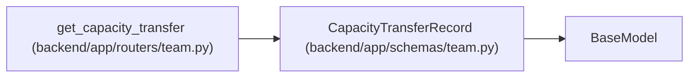

# CapacityTransferRecord

**Location:** `backend/app/schemas/team.py:616`
**Kind:** Pydantic model
**Bases:** `BaseModel`
**Module:** [schemas_team](../modules/schemas_team.md)

## Description

A recorded transfer: every row it changes and whether it is still active.

## Attributes

| Name | Type | Wire name | Required | Nullable | Default | Constraints | Examples | Description |
|------|------|-----------|----------|----------|---------|-------------|-------------|----------|
| `group_token` | `str` | `group_token` | Yes | No | — | — | — | — |
| `active` | `bool` | `active` | Yes | No | — | — | — | — |
| `profile_id` | `Optional[int]` | `profile_id` | No | Yes | `None` | — | — | — |
| `start_date` | `date` | `start_date` | Yes | No | — | — | — | — |
| `end_date` | `date` | `end_date` | Yes | No | — | — | — | — |
| `returns_on` | `date` | `returns_on` | Yes | No | — | — | — | — |
| `reason` | `str` | `reason` | Yes | No | — | — | — | — |
| `created_by_principal_id` | `Optional[int]` | `created_by_principal_id` | No | Yes | `None` | — | — | — |
| `created_at` | `Optional[datetime]` | `created_at` | No | Yes | `None` | — | — | — |
| `withdrawn_at` | `Optional[datetime]` | `withdrawn_at` | No | Yes | `None` | — | — | — |
| `withdrawal_reason` | `Optional[str]` | `withdrawal_reason` | No | Yes | `None` | — | — | — |
| `withdrawn_group_token` | `Optional[str]` | `withdrawn_group_token` | No | Yes | `None` | — | — | — |
| `target` | `CapacityTransferSide` | `target` | Yes | No | — | — | — | — |
| `sources` | `list[CapacityTransferSide]` | `sources` | Yes | No | — | — | — | — |

## Methods

*No declared methods.*

## Relationships

<!-- Auto-generated relationship summary. Do not edit by hand. -->

### Summary

| Module | Methods | Attributes |
|---|---:|---|
| [schemas_team](../modules/schemas_team.md) | 0 | `active`, `created_at`, `created_by_principal_id`, `end_date`, `group_token`, `profile_id`, `reason`, `returns_on`, `sources`, `start_date`, `target`, `withdrawal_reason` |

### Structure

| Kind | Entity | Module |
|---|---|---|
| Base | `BaseModel` | — |

### References

| Reference | Kind | Source | Call sites |
|---|---|---|---:|
| `get_capacity_transfer` | type_reference | [routers_team](../modules/routers_team.md) | — |
