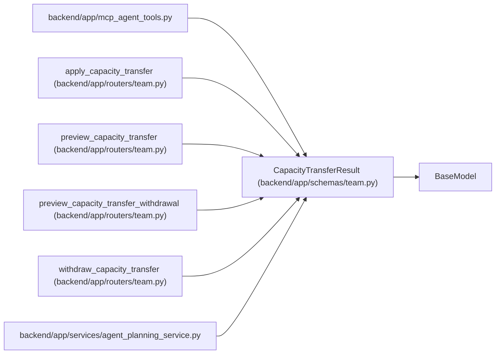

# CapacityTransferResult

**Location:** `backend/app/schemas/team.py:590`
**Kind:** Pydantic model
**Bases:** `BaseModel`
**Module:** [schemas_team](../modules/schemas_team.md)

## Description

Effective capacity of every row of a transfer, and the adjustments the command records or withdraws.

## Attributes

| Name | Type | Wire name | Required | Nullable | Default | Constraints | Examples | Description |
|------|------|-----------|----------|----------|---------|-------------|-------------|----------|
| `applied` | `bool` | `applied` | Yes | No | — | — | — | — |
| `action` | `Literal['transfer', 'withdrawal']` | `action` | Yes | No | — | — | — | — |
| `group_token` | `Optional[str]` | `group_token` | No | Yes | `None` | — | — | — |
| `withdrawal_group_token` | `Optional[str]` | `withdrawal_group_token` | No | Yes | `None` | — | — | — |
| `profile_id` | `Optional[int]` | `profile_id` | No | Yes | `None` | — | — | — |
| `start_date` | `date` | `start_date` | Yes | No | — | — | — | — |
| `end_date` | `date` | `end_date` | Yes | No | — | — | — | — |
| `returns_on` | `date` | `returns_on` | Yes | No | — | — | — | — |
| `restored_from` | `Optional[date]` | `restored_from` | No | Yes | `None` | — | — | — |
| `reason` | `str` | `reason` | Yes | No | — | — | — | — |
| `target` | `CapacityTransferSide` | `target` | Yes | No | — | — | — | — |
| `sources` | `list[CapacityTransferSide]` | `sources` | Yes | No | — | — | — | — |
| `person_capacity` | `list[PersonCapacityDay]` | `person_capacity` | No | No | factory: `list` | — | — | — |
| `observed_revisions` | `dict[int, int]` | `observed_revisions` | Yes | No | — | — | — | — |
| `resulting_revisions` | `dict[int, int]` | `resulting_revisions` | No | No | factory: `dict` | — | — | — |
| `planning_revision` | `Optional[int]` | `planning_revision` | No | Yes | `None` | — | — | — |
| `formula` | `str` | `formula` | No | No | `"source percentage = its own percentage - the lent percentage; target percentage = its own percentage + the sum of lent percentages, on each date of the transfer only; row hours = person calendar hours after absence × the row's percentage on that date"` | — | — | — |

## Methods

*No declared methods.*

## Relationships

<!-- Auto-generated relationship summary. Do not edit by hand. -->

### Summary

| Module | Methods | Attributes |
|---|---:|---|
| [schemas_team](../modules/schemas_team.md) | 0 | `action`, `applied`, `end_date`, `formula`, `group_token`, `observed_revisions`, `person_capacity`, `planning_revision`, `profile_id`, `reason`, `restored_from`, `resulting_revisions` |

### Structure

| Kind | Entity | Module |
|---|---|---|
| Base | `BaseModel` | — |

### References

| Reference | Kind | Source | Call sites |
|---|---|---|---:|
| `mcp_agent_tools` | import | [mcp_agent_tools](../modules/mcp_agent_tools.md) | — |
| `apply_capacity_transfer` | type_reference | [routers_team](../modules/routers_team.md) | — |
| `preview_capacity_transfer` | type_reference | [routers_team](../modules/routers_team.md) | — |
| `preview_capacity_transfer_withdrawal` | type_reference | [routers_team](../modules/routers_team.md) | — |
| `withdraw_capacity_transfer` | type_reference | [routers_team](../modules/routers_team.md) | — |
| `agent_planning_service` | import | [agent_planning_service](../modules/agent_planning_service.md) | — |
