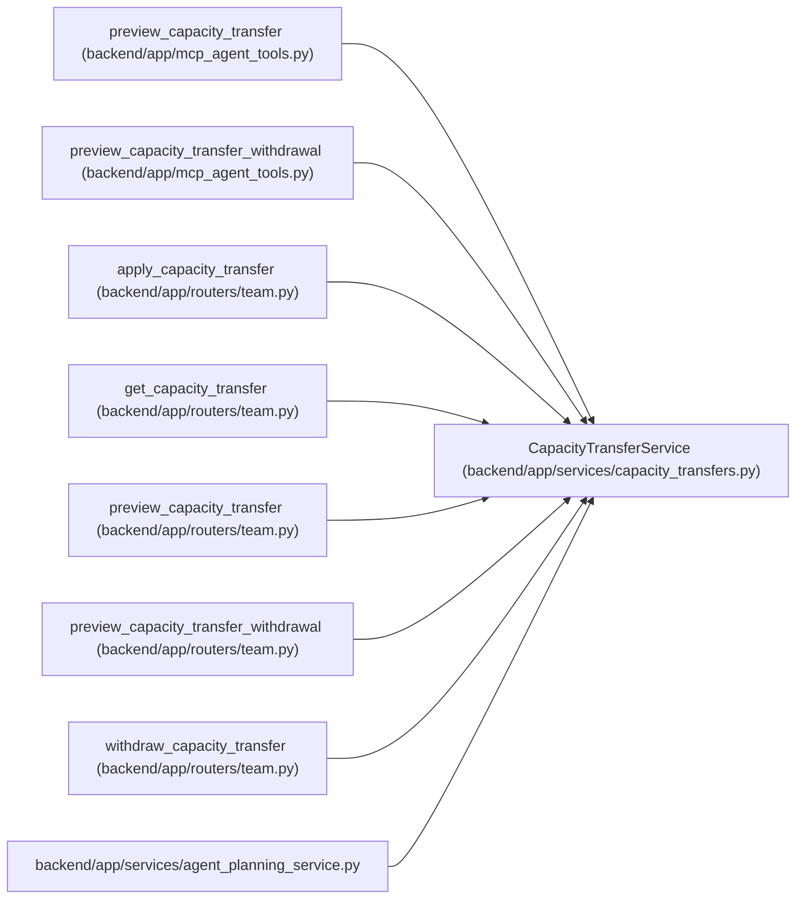

# CapacityTransferService

**Location:** `backend/app/services/capacity_transfers.py:131`
**Kind:** Class
**Bases:** —
**Module:** [capacity_transfers](../modules/capacity_transfers.md)

## Description

Preview, record, withdraw and read temporary capacity transfers.

## Attributes

*No annotated attributes found.*

## Methods

| Method | Signature | Decorators | Description |
|--------|-----------|------------|-------------|
| `__init__` | `(db)` | — | — |
| `_members` | *(async)* `(member_ids)` | — | — |
| `_today` | `(members)` | `@staticmethod` | The latest current date among the rows' zones, so no row's past is changed. |
| `_row_hours` | *(async)* `(member)` | — | — |
| `_side` | *(async)* `(role, member, adjustment, hours, days, before, after, *, persisted = True, retained = None, retained_persisted = True)` | — | — |
| `_person` | *(async)* `(member, start, end)` | — | — |
| `_person_days` | `(before, after)` | `@staticmethod` | — |
| `_audit` | `(action, member, adjustment, role, token, reason, details)` | — | — |
| `preview` | *(async)* `(data)` | `@preview_command` | Calculate both rows' effective capacity with the transfer, then roll everything back. |
| `apply` | *(async)* `(data, *, commit: bool = True)` | `@schedule_input_command(TRANSFER_KIND)` | Record every side of the transfer under the observed planning revisions. |
| `_transfer` | *(async)* `(data)` | — | — |
| `preview_withdrawal` | *(async)* `(group_token, data)` | `@preview_command` | Calculate the capacity every row gets back, then roll everything back. |
| `withdraw` | *(async)* `(group_token, data, *, commit: bool = True)` | `@schedule_input_command(TRANSFER_KIND)` | Return the lent capacity of every row of the transfer together. |
| `_group` | *(async)* `(group_token, *, lock = False)` | — | — |
| `_role` | `(row)` | `@staticmethod` | — |
| `_withdraw` | *(async)* `(group_token, data)` | — | — |
| `get` | *(async)* `(group_token)` | — | Read every row of one transfer; the caller must be able to read all of them. |

## Relationships

<!-- Auto-generated relationship summary. Do not edit by hand. -->

### Summary

| Module | Methods | Attributes |
|---|---:|---|
| [capacity_transfers](../modules/capacity_transfers.md) | 17 | — |

### References

| Reference | Kind | Source | Call sites |
|---|---|---|---:|
| `preview_capacity_transfer` | call | [mcp_agent_tools](../modules/mcp_agent_tools.md) | 1 |
| `preview_capacity_transfer_withdrawal` | call | [mcp_agent_tools](../modules/mcp_agent_tools.md) | 1 |
| `apply_capacity_transfer` | call | [routers_team](../modules/routers_team.md) | 1 |
| `get_capacity_transfer` | call | [routers_team](../modules/routers_team.md) | 1 |
| `preview_capacity_transfer` | call | [routers_team](../modules/routers_team.md) | 1 |
| `preview_capacity_transfer_withdrawal` | call | [routers_team](../modules/routers_team.md) | 1 |
| `withdraw_capacity_transfer` | call | [routers_team](../modules/routers_team.md) | 1 |
| `agent_planning_service` | import | [agent_planning_service](../modules/agent_planning_service.md) | — |
