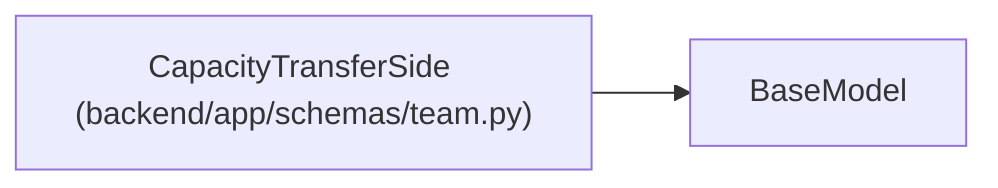

# CapacityTransferSide

**Location:** `backend/app/schemas/team.py:564`
**Kind:** Pydantic model
**Bases:** `BaseModel`
**Module:** [schemas_team](../modules/schemas_team.md)

## Description

One row of a transfer: the target that receives or a source that lends.

## Attributes

| Name | Type | Wire name | Required | Nullable | Default | Constraints | Examples | Description |
|------|------|-----------|----------|----------|---------|-------------|-------------|----------|
| `role` | `Literal['target', 'source']` | `role` | Yes | No | — | — | — | — |
| `member_id` | `int` | `member_id` | Yes | No | — | — | — | — |
| `iteration_id` | `Optional[int]` | `iteration_id` | No | Yes | `None` | — | — | — |
| `project_id` | `Optional[int]` | `project_id` | No | Yes | `None` | — | — | — |
| `base_availability_percent` | `float` | `base_availability_percent` | Yes | No | — | — | — | — |
| `transferred_percent` | `float` | `transferred_percent` | Yes | No | — | — | — | — |
| `availability_percent` | `float` | `availability_percent` | Yes | No | — | — | — | — |
| `adjustment` | `Optional[CapacityAdjustmentResponse]` | `adjustment` | No | Yes | `None` | — | — | — |
| `retained` | `Optional[CapacityAdjustmentResponse]` | `retained` | No | Yes | `None` | — | — | — |
| `effective_capacity` | `list[CapacityTransferDay]` | `effective_capacity` | No | No | factory: `list` | — | — | — |

## Methods

*No declared methods.*

## Relationships

<!-- Auto-generated relationship summary. Do not edit by hand. -->

### Summary

| Module | Methods | Attributes |
|---|---:|---|
| [schemas_team](../modules/schemas_team.md) | 0 | `adjustment`, `availability_percent`, `base_availability_percent`, `effective_capacity`, `iteration_id`, `member_id`, `project_id`, `retained`, `role`, `transferred_percent` |

### Structure

| Kind | Entity | Module |
|---|---|---|
| Base | `BaseModel` | — |
