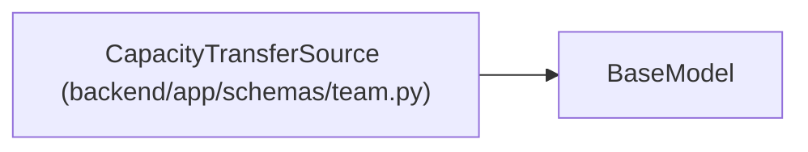

# CapacityTransferSource

**Location:** `backend/app/schemas/team.py:502`
**Kind:** Pydantic model
**Bases:** `BaseModel`
**Module:** [schemas_team](../modules/schemas_team.md)

## Description

A capacity row that lends part of its availability percentage.

## Attributes

| Name | Type | Wire name | Required | Nullable | Default | Constraints | Examples | Description |
|------|------|-----------|----------|----------|---------|-------------|-------------|----------|
| `member_id` | `int` | `member_id` | Yes | No | — | ge=1 | — | — |
| `transferred_percent` | `float` | `transferred_percent` | Yes | No | — | gt=0; le=100 | — | — |

## Methods

*No declared methods.*

## Relationships

<!-- Auto-generated relationship summary. Do not edit by hand. -->

### Summary

| Module | Methods | Attributes |
|---|---:|---|
| [schemas_team](../modules/schemas_team.md) | 0 | `member_id`, `transferred_percent` |

### Structure

| Kind | Entity | Module |
|---|---|---|
| Base | `BaseModel` | — |
