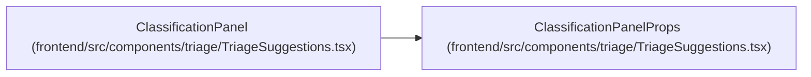

# ClassificationPanelProps

**Location:** `frontend/src/components/triage/TriageSuggestions.tsx:140`
**Kind:** Interface
**Bases:** —
**Module:** [TriageSuggestions](../modules/TriageSuggestions.md)

## Description

_Auto-generated from `ClassificationPanelProps` in `frontend/src/components/triage/TriageSuggestions.tsx`._

## Attributes

| Name | Type | Required | Default | Description |
|------|------|----------|---------|-------------|
| `suggestions` | `TriageClassificationSuggestion[]` | No | — | — |
| `isLoading` | `boolean` | Yes | — | — |
| `isError` | `boolean` | Yes | — | — |
| `error` | `unknown` | No | — | — |
| `onRetry` | `() => void` | Yes | — | — |
| `onClassify` | `() => void` | Yes | — | — |
| `isClassifying` | `boolean` | Yes | — | — |
| `classifyError` | `string \| null` | Yes | — | — |

## Methods

*No declared methods.*

## Relationships

<!-- Auto-generated relationship summary. Do not edit by hand. -->

### Summary

| Module | Methods | Attributes |
|---|---:|---|
| [TriageSuggestions](../modules/TriageSuggestions.md) | 0 | `classifyError`, `error`, `isClassifying`, `isError`, `isLoading`, `onClassify`, `onRetry`, `suggestions` |

### References

| Reference | Kind | Source | Call sites |
|---|---|---|---:|
| `ClassificationPanel` | type_reference | [TriageSuggestions](../modules/TriageSuggestions.md) | — |
