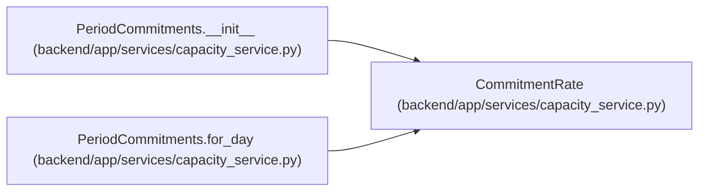

# CommitmentRate

**Location:** `backend/app/services/capacity_service.py:37`
**Kind:** Class
**Bases:** —
**Module:** [capacity_service](../modules/capacity_service.md)

**Decorators:** `@dataclass`

## Description

_Auto-generated from `CommitmentRate` in `backend/app/services/capacity_service.py`._

A profile accumulates these rates as baseline intervals start and finish. A positive productivity factor distributes effort in proportion to working hours. A zero factor uses the established equal share per positive workday. Separate counters retain unknown effort and missing rules.

## Attributes

| Name | Type | Default | Description |
|------|------|---------|-------------|
| `per_hour` | `float` | `0.0` | — |
| `per_workday` | `float` | `0.0` | — |
| `unknown_effort` | `int` | `0` | — |
| `unknown_coverage` | `int` | `0` | — |
| `count` | `int` | `0` | — |

## Methods

| Method | Signature | Decorators | Description |
|--------|-----------|------------|-------------|
| `adjust` | `(rate, direction)` | — | — |

## Relationships

<!-- Auto-generated relationship summary. Do not edit by hand. -->

### Summary

| Module | Methods | Attributes |
|---|---:|---|
| [capacity_service](../modules/capacity_service.md) | 1 | `count`, `per_hour`, `per_workday`, `unknown_coverage`, `unknown_effort` |

### References

| Reference | Kind | Source | Call sites |
|---|---|---|---:|
| `PeriodCommitments.__init__` | call | [capacity_service](../modules/capacity_service.md) | 1 |
| `PeriodCommitments.for_day` | call | [capacity_service](../modules/capacity_service.md) | 1 |
