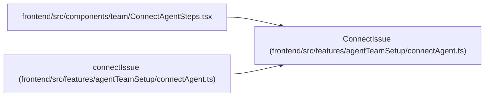

# ConnectIssue

**Location:** `frontend/src/features/agentTeamSetup/connectAgent.ts:154`
**Kind:** Interface
**Bases:** —
**Module:** [connectAgent](../modules/connectAgent.md)

## Description

_Auto-generated from `ConnectIssue` in `frontend/src/features/agentTeamSetup/connectAgent.ts`._

## Attributes

| Name | Type | Required | Default | Description |
|------|------|----------|---------|-------------|
| `step` | `number` | Yes | — | — |
| `reason` | `ConnectIssueReason` | Yes | — | — |
| `code` | `string` | Yes | — | — |

## Methods

*No declared methods.*

## Relationships

<!-- Auto-generated relationship summary. Do not edit by hand. -->

### Summary

| Module | Methods | Attributes |
|---|---:|---|
| [connectAgent](../modules/connectAgent.md) | 0 | `code`, `reason`, `step` |

### References

| Reference | Kind | Source | Call sites |
|---|---|---|---:|
| `ConnectAgentSteps` | import | [ConnectAgentSteps](../modules/ConnectAgentSteps.md) | — |
| `connectIssue` | type_reference | [connectAgent](../modules/connectAgent.md) | — |
