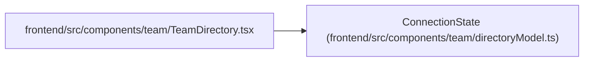

# ConnectionState

**Location:** `frontend/src/components/team/directoryModel.ts:7`
**Kind:** Type alias
**Bases:** —
**Module:** [directoryModel](../modules/directoryModel.md)
**Target:**

```typescript
'connected' | 'not_connected' | 'unknown'
```

## Description

Connected and Not connected are read from the roster; Unknown means the roster could not be read.

## Attributes

*See the alias definition for its member types.*

## Methods

*See the alias definition for callable and member types.*

## Relationships

<!-- Auto-generated relationship summary. Do not edit by hand. -->


### Summary

| Module | Methods | Attributes |
|---|---:|---|
| [directoryModel](../modules/directoryModel.md) | 0 | — |

### References

| Reference | Kind | Source | Call sites |
|---|---|---|---:|
| `TeamDirectory` | import | [TeamDirectory](../modules/TeamDirectory.md) | — |
