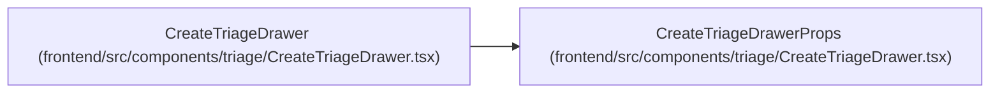

# CreateTriageDrawerProps

**Location:** `frontend/src/components/triage/CreateTriageDrawer.tsx:30`
**Kind:** Interface
**Bases:** —
**Module:** [CreateTriageDrawer](../modules/CreateTriageDrawer.md)

## Description

_Auto-generated from `CreateTriageDrawerProps` in `frontend/src/components/triage/CreateTriageDrawer.tsx`._

## Attributes

| Name | Type | Required | Default | Description |
|------|------|----------|---------|-------------|
| `projects` | `Project[]` | Yes | — | — |
| `iterations` | `Iteration[]` | Yes | — | — |
| `isSubmitting` | `boolean` | Yes | — | — |
| `error` | `string \| null` | No | — | — |
| `sourceUrlError` | `string \| null` | No | — | — |
| `onSubmit` | `(payload: TriageItemCreate) => void` | Yes | — | — |
| `onClose` | `() => void` | Yes | — | — |
| `initialTitle` | `string` | No | — | — |

## Methods

*No declared methods.*

## Relationships

<!-- Auto-generated relationship summary. Do not edit by hand. -->

### Summary

| Module | Methods | Attributes |
|---|---:|---|
| [CreateTriageDrawer](../modules/CreateTriageDrawer.md) | 0 | `error`, `initialTitle`, `isSubmitting`, `iterations`, `onClose`, `onSubmit`, `projects`, `sourceUrlError` |

### References

| Reference | Kind | Source | Call sites |
|---|---|---|---:|
| `CreateTriageDrawer` | type_reference | [CreateTriageDrawer](../modules/CreateTriageDrawer.md) | — |
