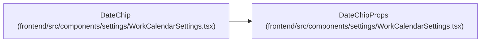

# DateChipProps

**Location:** `frontend/src/components/settings/WorkCalendarSettings.tsx:993`
**Kind:** Interface
**Bases:** —
**Module:** [WorkCalendarSettings](../modules/WorkCalendarSettings.md)

## Description

_Auto-generated from `DateChipProps` in `frontend/src/components/settings/WorkCalendarSettings.tsx`._

## Attributes

| Name | Type | Required | Default | Description |
|------|------|----------|---------|-------------|
| `dateKey` | `string` | Yes | — | — |
| `locale` | `Locale` | Yes | — | — |
| `label` | `string` | Yes | — | — |
| `onRemove` | `() => void` | Yes | — | — |

## Methods

*No declared methods.*

## Relationships

<!-- Auto-generated relationship summary. Do not edit by hand. -->

### Summary

| Module | Methods | Attributes |
|---|---:|---|
| [WorkCalendarSettings](../modules/WorkCalendarSettings.md) | 0 | `dateKey`, `label`, `locale`, `onRemove` |

### References

| Reference | Kind | Source | Call sites |
|---|---|---|---:|
| `DateChip` | type_reference | [WorkCalendarSettings](../modules/WorkCalendarSettings.md) | — |
