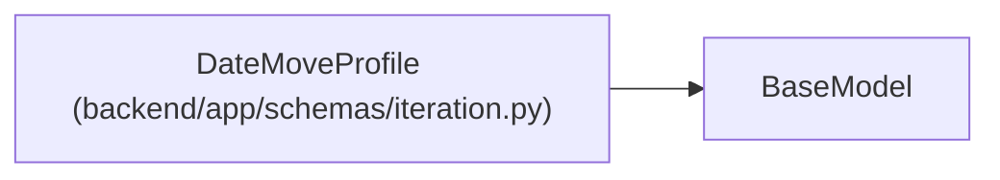

# DateMoveProfile

**Location:** `backend/app/schemas/iteration.py:237`
**Kind:** Pydantic model
**Bases:** `BaseModel`
**Module:** [schemas_iteration](../modules/schemas_iteration.md)

## Description

How the proposed period fits one person of the iteration team.

## Attributes

| Name | Type | Wire name | Required | Nullable | Default | Constraints | Examples | Description |
|------|------|-----------|----------|----------|---------|-------------|-------------|----------|
| `profile_id` | `int` | `profile_id` | Yes | No | — | — | — | — |
| `member_ids` | `list[int]` | `member_ids` | Yes | No | — | — | — | — |
| `shortfall_days` | `int` | `shortfall_days` | Yes | No | — | — | — | — |
| `shortfall_hours` | `float` | `shortfall_hours` | Yes | No | — | — | — | — |
| `first_shortfall_date` | `Optional[date]` | `first_shortfall_date` | No | Yes | `None` | — | — | — |
| `calendar_uncertain` | `bool` | `calendar_uncertain` | No | No | `False` | — | — | — |
| `missing_calendar_years` | `list[int]` | `missing_calendar_years` | No | No | factory: `list` | — | — | — |

## Methods

*No declared methods.*

## Relationships

<!-- Auto-generated relationship summary. Do not edit by hand. -->

### Summary

| Module | Methods | Attributes |
|---|---:|---|
| [schemas_iteration](../modules/schemas_iteration.md) | 0 | `calendar_uncertain`, `first_shortfall_date`, `member_ids`, `missing_calendar_years`, `profile_id`, `shortfall_days`, `shortfall_hours` |

### Structure

| Kind | Entity | Module |
|---|---|---|
| Base | `BaseModel` | — |
