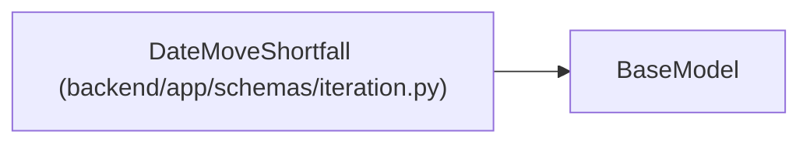

# DateMoveShortfall

**Location:** `backend/app/schemas/iteration.py:220`
**Kind:** Pydantic model
**Bases:** `BaseModel`
**Module:** [schemas_iteration](../modules/schemas_iteration.md)

## Description

One person and date where the proposed period requests more than the person has.

## Attributes

| Name | Type | Wire name | Required | Nullable | Default | Constraints | Examples | Description |
|------|------|-----------|----------|----------|---------|-------------|-------------|----------|
| `profile_id` | `int` | `profile_id` | Yes | No | — | — | — | — |
| `member_ids` | `list[int]` | `member_ids` | Yes | No | — | — | — | — |
| `date` | `date` | `date` | Yes | No | — | — | — | — |
| `available_hours` | `float` | `available_hours` | Yes | No | — | — | — | — |
| `requested_hours` | `float` | `requested_hours` | Yes | No | — | — | — | — |
| `booked_elsewhere_hours` | `float` | `booked_elsewhere_hours` | Yes | No | — | — | — | — |
| `private_booked_hours` | `float` | `private_booked_hours` | No | No | `0.0` | — | — | — |
| `bookings` | `list[DateMoveBooking]` | `bookings` | No | No | factory: `list` | — | — | — |
| `overallocated_hours` | `float` | `overallocated_hours` | Yes | No | — | — | — | — |
| `shortfall_hours` | `float` | `shortfall_hours` | Yes | No | — | — | — | — |
| `current_overallocated_hours` | `Optional[float]` | `current_overallocated_hours` | No | Yes | `None` | — | — | — |

## Methods

*No declared methods.*

## Relationships

<!-- Auto-generated relationship summary. Do not edit by hand. -->

### Summary

| Module | Methods | Attributes |
|---|---:|---|
| [schemas_iteration](../modules/schemas_iteration.md) | 0 | `available_hours`, `booked_elsewhere_hours`, `bookings`, `current_overallocated_hours`, `date`, `member_ids`, `overallocated_hours`, `private_booked_hours`, `profile_id`, `requested_hours`, `shortfall_hours` |

### Structure

| Kind | Entity | Module |
|---|---|---|
| Base | `BaseModel` | — |
