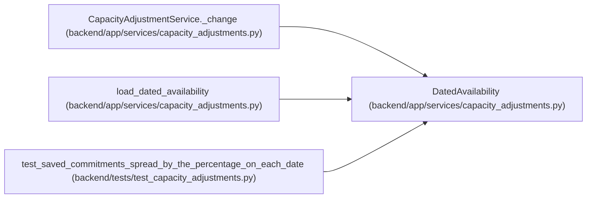

# DatedAvailability

**Location:** `backend/app/services/capacity_adjustments.py:33`
**Kind:** Class
**Bases:** —
**Module:** [capacity_adjustments](../modules/capacity_adjustments.md)

## Description

The effective availability percentage of capacity rows on each date.

## Attributes

*No annotated attributes found.*

## Methods

| Method | Signature | Decorators | Description |
|--------|-----------|------------|-------------|
| `__init__` | `(ranges = None)` | — | — |
| `has_adjustments` | `(member_id)` | — | — |
| `percent` | `(member, day)` | — | — |
| `adjusted_days` | `(member)` | — | Yield each adjusted date and its percentage. |
| `any_positive` | `(member)` | — | — |
| `signature` | `(member_id)` | — | — |

## Relationships

<!-- Auto-generated relationship summary. Do not edit by hand. -->

### Summary

| Module | Methods | Attributes |
|---|---:|---|
| [capacity_adjustments](../modules/capacity_adjustments.md) | 6 | — |

### References

| Reference | Kind | Source | Call sites |
|---|---|---|---:|
| `CapacityAdjustmentService._change` | call | [capacity_adjustments](../modules/capacity_adjustments.md) | 2 |
| `load_dated_availability` | call | [capacity_adjustments](../modules/capacity_adjustments.md) | 2 |
| `test_saved_commitments_spread_by_the_percentage_on_each_date` | call | [test_capacity_adjustments](../modules/test_capacity_adjustments.md) | 2 |
