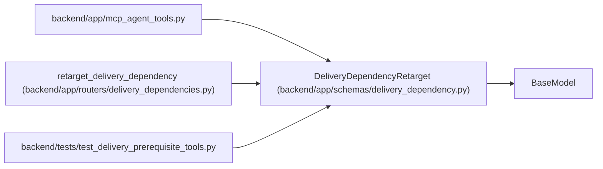

# DeliveryDependencyRetarget

**Location:** `backend/app/schemas/delivery_dependency.py:17`
**Kind:** Pydantic model
**Bases:** `BaseModel`
**Module:** [schemas_delivery_dependency](../modules/schemas_delivery_dependency.md)

## Description

Change the target branch of an existing task prerequisite; null keeps only the acceptance gate.

## Model Configuration

| Setting | Value | Source |
|---------|-------|--------|
| `extra` | `'forbid'` | model_config |

## Attributes

| Name | Type | Wire name | Required | Nullable | Default | Constraints | Examples | Description |
|------|------|-----------|----------|----------|---------|-------------|-------------|----------|
| `expected_version` | `int` | `expected_version` | Yes | No | — | gt=0 | — | — |
| `target_branch` | `str \| None` | `target_branch` | Yes | Yes | — | max_length=255 | — | — |

## Methods

*No declared methods.*

## Relationships

<!-- Auto-generated relationship summary. Do not edit by hand. -->

### Summary

| Module | Methods | Attributes |
|---|---:|---|
| [schemas_delivery_dependency](../modules/schemas_delivery_dependency.md) | 0 | `expected_version`, `target_branch` |

### Structure

| Kind | Entity | Module |
|---|---|---|
| Base | `BaseModel` | — |

### References

| Reference | Kind | Source | Call sites |
|---|---|---|---:|
| `mcp_agent_tools` | import | [mcp_agent_tools](../modules/mcp_agent_tools.md) | — |
| `retarget_delivery_dependency` | type_reference | [delivery_dependencies](../modules/delivery_dependencies.md) | — |
| `test_delivery_prerequisite_tools` | import | [test_delivery_prerequisite_tools](../modules/test_delivery_prerequisite_tools.md) | — |
