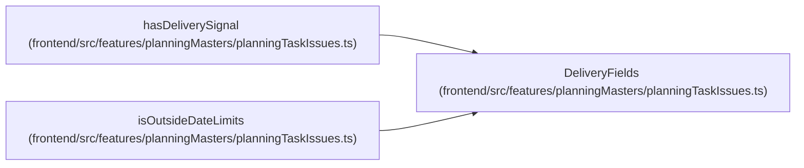

# DeliveryFields

**Location:** `frontend/src/features/planningMasters/planningTaskIssues.ts:56`
**Kind:** Type alias
**Bases:** —
**Module:** [planningTaskIssues](../modules/planningTaskIssues.md)
**Target:**

```typescript
Pick<Task, 'is_overdue' | 'is_delayed' | 'is_outside_constraints'>
    & Partial<Pick<Task, 'start_date' | 'end_date' | 'min_start_date' | 'max_end_date'>>
```

## Description

_Auto-generated from `DeliveryFields` in `frontend/src/features/planningMasters/planningTaskIssues.ts`._

## Attributes

*See the alias definition for its member types.*

## Methods

*See the alias definition for callable and member types.*

## Relationships

<!-- Auto-generated relationship summary. Do not edit by hand. -->


### Summary

| Module | Methods | Attributes |
|---|---:|---|
| [planningTaskIssues](../modules/planningTaskIssues.md) | 0 | — |

### References

| Reference | Kind | Source | Call sites |
|---|---|---|---:|
| `hasDeliverySignal` | type_reference | [planningTaskIssues](../modules/planningTaskIssues.md) | — |
| `isOutsideDateLimits` | type_reference | [planningTaskIssues](../modules/planningTaskIssues.md) | — |
