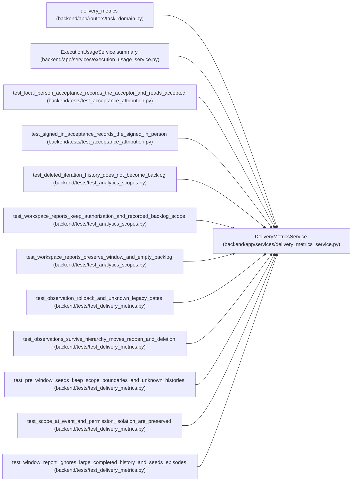

# DeliveryMetricsService

**Location:** `backend/app/services/delivery_metrics_service.py:120`
**Kind:** Class
**Bases:** —
**Module:** [delivery_metrics_service](../modules/delivery_metrics_service.md)

## Description

_Auto-generated from `DeliveryMetricsService` in `backend/app/services/delivery_metrics_service.py`._

## Attributes

*No annotated attributes found.*

## Methods

| Method | Signature | Decorators | Description |
|--------|-----------|------------|-------------|
| `__init__` | `(db)` | — | — |
| `_window_observations` | *(async)* `(observed, start)` | — | Read the window and at most four prior state facts per relevant identity. |
| `report` | *(async)* `(*, project_id = None, iteration_id = None, lookback_days = 30, now = None, backlog = False, all_projects = False, all_projects_backlog = False)` | — | — |

## Relationships

<!-- Auto-generated relationship summary. Do not edit by hand. -->

### Summary

| Module | Methods | Attributes |
|---|---:|---|
| [delivery_metrics_service](../modules/delivery_metrics_service.md) | 3 | — |

### References

| Reference | Kind | Source | Call sites |
|---|---|---|---:|
| `delivery_metrics` | call | [routers_task_domain](../modules/routers_task_domain.md) | 1 |
| `ExecutionUsageService.summary` | call | [execution_usage_service](../modules/execution_usage_service.md) | 1 |
| `test_local_person_acceptance_records_the_acceptor_and_reads_accepted` | call | [test_acceptance_attribution](../modules/test_acceptance_attribution.md) | 1 |
| `test_signed_in_acceptance_records_the_signed_in_person` | call | [test_acceptance_attribution](../modules/test_acceptance_attribution.md) | 1 |
| `test_deleted_iteration_history_does_not_become_backlog` | call | [test_analytics_scopes](../modules/test_analytics_scopes.md) | 3 |
| `test_workspace_reports_keep_authorization_and_recorded_backlog_scope` | call | [test_analytics_scopes](../modules/test_analytics_scopes.md) | 1 |
| `test_workspace_reports_preserve_window_and_empty_backlog` | call | [test_analytics_scopes](../modules/test_analytics_scopes.md) | 1 |
| `test_observation_rollback_and_unknown_legacy_dates` | call | [test_delivery_metrics](../modules/test_delivery_metrics.md) | 1 |
| `test_observations_survive_hierarchy_moves_reopen_and_deletion` | call | [test_delivery_metrics](../modules/test_delivery_metrics.md) | 1 |
| `test_pre_window_seeds_keep_scope_boundaries_and_unknown_histories` | call | [test_delivery_metrics](../modules/test_delivery_metrics.md) | 1 |
| `test_scope_at_event_and_permission_isolation_are_preserved` | call | [test_delivery_metrics](../modules/test_delivery_metrics.md) | 3 |
| `test_window_report_ignores_large_completed_history_and_seeds_episodes` | call | [test_delivery_metrics](../modules/test_delivery_metrics.md) | 2 |

> References: showing 12 of 15 logical references; 3 omitted by the 12-row generated summary limit.
