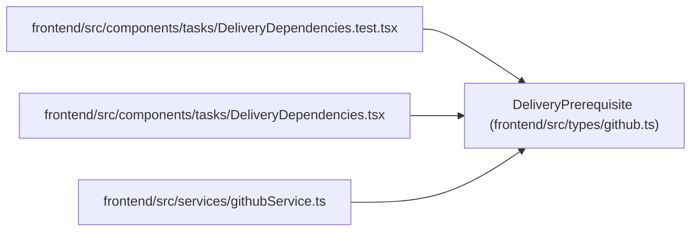

# DeliveryPrerequisite

**Location:** `frontend/src/types/github.ts:99`
**Kind:** Interface
**Bases:** —
**Module:** [types_github](../modules/types_github.md)

## Description

One delivery prerequisite of a task as the projection returns it: its target task or milestone, whether it is ready, the optional target branch on which accepted code must be merged, the stored merge evidence and, when it is not ready, the hold that names who acts next.

## Attributes

| Name | Type | Required | Default | Description |
|------|------|----------|---------|-------------|
| `id` | `number` | Yes | — | — |
| `kind` | `'task' \| 'milestone'` | Yes | — | — |
| `target_id` | `number` | No | — | — |
| `title` | `string` | No | — | — |
| `ready` | `boolean` | Yes | — | — |
| `reason` | `string \| null` | Yes | — | — |
| `target_branch` | `string \| null` | No | — | — |
| `merge` | `{ state: string; verified: boolean; target_branch: string } \| null` | No | — | — |
| `hold` | `DeliveryPrerequisiteHold \| null` | No | — | — |

## Methods

*No declared methods.*

## Relationships

<!-- Auto-generated relationship summary. Do not edit by hand. -->

### Summary

| Module | Methods | Attributes |
|---|---:|---|
| [types_github](../modules/types_github.md) | 0 | `hold`, `id`, `kind`, `merge`, `ready`, `reason`, `target_branch`, `target_id`, `title` |

### References

| Reference | Kind | Source | Call sites |
|---|---|---|---:|
| `DeliveryDependencies.test` | import | [DeliveryDependencies.test](../modules/DeliveryDependencies.test.md) | — |
| `DeliveryDependencies` | import | [DeliveryDependencies](../modules/DeliveryDependencies.md) | — |
| `githubService` | import | [githubService](../modules/githubService.md) | — |
