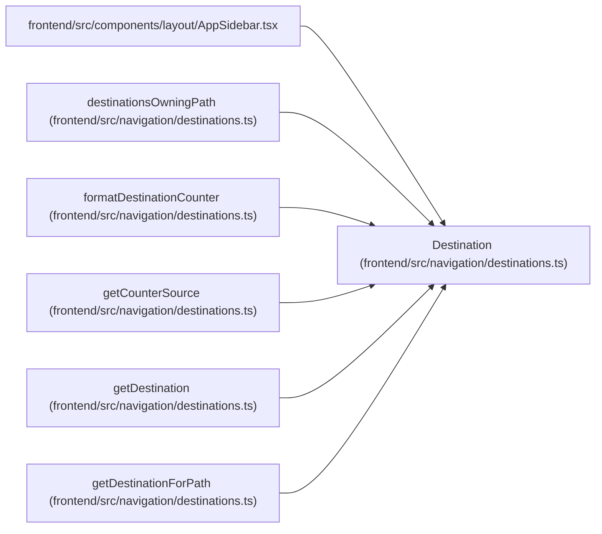

# Destination

**Location:** `frontend/src/navigation/destinations.ts:44`
**Kind:** Interface
**Bases:** —
**Module:** [destinations](../modules/destinations.md)

## Description

_Auto-generated from `Destination` in `frontend/src/navigation/destinations.ts`._

## Attributes

| Name | Type | Required | Default | Description |
|------|------|----------|---------|-------------|
| `id` | `DestinationId` | Yes | — | — |
| `path` | `string` | Yes | — | — |
| `labelKey` | `string` | Yes | — | — |
| `defaultLabel` | `string` | Yes | — | — |
| `icon` | `LucideIcon` | Yes | — | — |
| `counter` | `DestinationCounterSource` | No | — | — |
| `owns` | `readonly string[]` | Yes | — | — |

## Methods

*No declared methods.*

## Relationships

<!-- Auto-generated relationship summary. Do not edit by hand. -->

### Summary

| Module | Methods | Attributes |
|---|---:|---|
| [destinations](../modules/destinations.md) | 0 | `counter`, `defaultLabel`, `icon`, `id`, `labelKey`, `owns`, `path` |

### References

| Reference | Kind | Source | Call sites |
|---|---|---|---:|
| `AppSidebar` | import | [AppSidebar](../modules/AppSidebar.md) | — |
| `destinationsOwningPath` | type_reference | [destinations](../modules/destinations.md) | — |
| `formatDestinationCounter` | type_reference | [destinations](../modules/destinations.md) | — |
| `getCounterSource` | type_reference | [destinations](../modules/destinations.md) | — |
| `getDestination` | type_reference | [destinations](../modules/destinations.md) | — |
| `getDestinationForPath` | type_reference | [destinations](../modules/destinations.md) | — |
