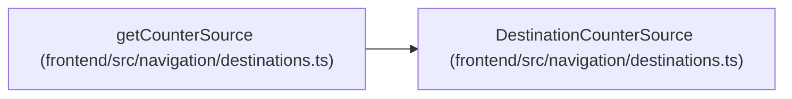

# DestinationCounterSource

**Location:** `frontend/src/navigation/destinations.ts:42`
**Kind:** Type alias
**Bases:** —
**Module:** [destinations](../modules/destinations.md)
**Target:**

```typescript
'none' | 'requestsWaiting' | 'planProgress'
```

## Description

Where a sidebar counter takes its number from.
- `none`: the destination shows no counter.
- `requestsWaiting`: the number of active Triage requests.
- `planProgress`: complete Plan checkpoints out of six, always shown once the server's checkpoint count is known, including a complete plan.

## Attributes

*See the alias definition for its member types.*

## Methods

*See the alias definition for callable and member types.*

## Relationships

<!-- Auto-generated relationship summary. Do not edit by hand. -->


### Summary

| Module | Methods | Attributes |
|---|---:|---|
| [destinations](../modules/destinations.md) | 0 | — |

### References

| Reference | Kind | Source | Call sites |
|---|---|---|---:|
| `getCounterSource` | type_reference | [destinations](../modules/destinations.md) | — |
