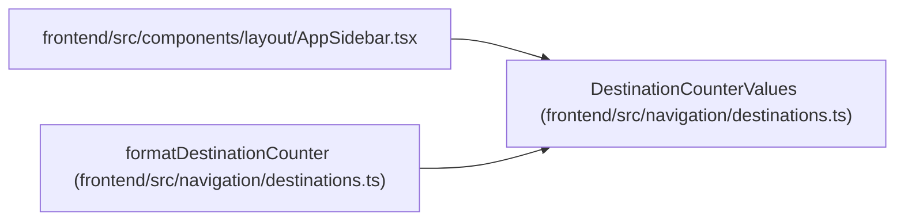

# DestinationCounterValues

**Location:** `frontend/src/navigation/destinations.ts:218`
**Kind:** Interface
**Bases:** —
**Module:** [destinations](../modules/destinations.md)

## Description

_Auto-generated from `DestinationCounterValues` in `frontend/src/navigation/destinations.ts`._

## Attributes

| Name | Type | Required | Default | Description |
|------|------|----------|---------|-------------|
| `requestsWaiting` | `number` | No | — | — |
| `planProgress` | `{ done: number; total: number }` | No | — | — |

## Methods

*No declared methods.*

## Relationships

<!-- Auto-generated relationship summary. Do not edit by hand. -->

### Summary

| Module | Methods | Attributes |
|---|---:|---|
| [destinations](../modules/destinations.md) | 0 | `planProgress`, `requestsWaiting` |

### References

| Reference | Kind | Source | Call sites |
|---|---|---|---:|
| `AppSidebar` | import | [AppSidebar](../modules/AppSidebar.md) | — |
| `formatDestinationCounter` | type_reference | [destinations](../modules/destinations.md) | — |
