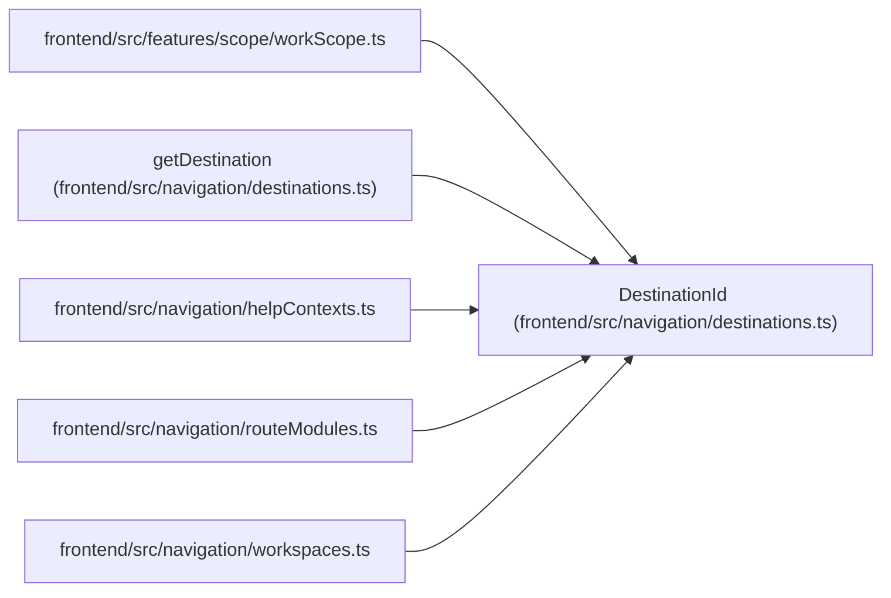

# DestinationId

**Location:** `frontend/src/navigation/destinations.ts:22`
**Kind:** Type alias
**Bases:** —
**Module:** [destinations](../modules/destinations.md)
**Target:**

```typescript
| 'overview'
    | 'my_work'
    | 'triage'
    | 'projects'
    | 'plan'
    | 'gantt'
    | 'tasks'
    | 'analytics'
    | 'team'
    | 'settings'
```

## Description

_Auto-generated from `DestinationId` in `frontend/src/navigation/destinations.ts`._

## Attributes

*See the alias definition for its member types.*

## Methods

*See the alias definition for callable and member types.*

## Relationships

<!-- Auto-generated relationship summary. Do not edit by hand. -->


### Summary

| Module | Methods | Attributes |
|---|---:|---|
| [destinations](../modules/destinations.md) | 0 | — |

### References

| Reference | Kind | Source | Call sites |
|---|---|---|---:|
| `workScope` | import | [workScope](../modules/workScope.md) | — |
| `getDestination` | type_reference | [destinations](../modules/destinations.md) | — |
| `helpContexts` | import | [helpContexts](../modules/helpContexts.md) | — |
| `routeModules` | import | [routeModules](../modules/routeModules.md) | — |
| `workspaces` | import | [workspaces](../modules/workspaces.md) | — |
