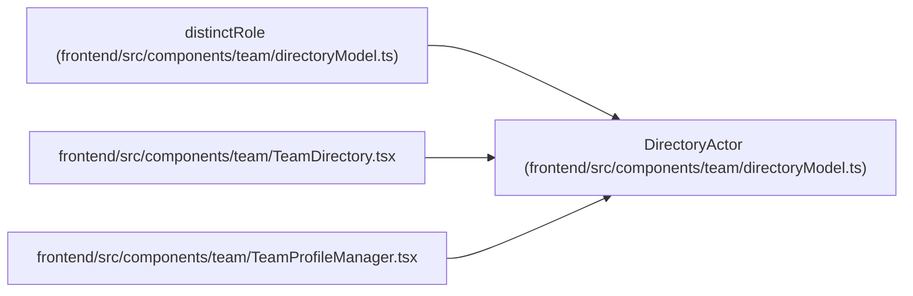

# DirectoryActor

**Location:** `frontend/src/components/team/directoryModel.ts:23`
**Kind:** Interface
**Bases:** —
**Module:** [directoryModel](../modules/directoryModel.md)

## Description

One agent actor as read from the roster: a profile can have several, for example a Worker and a Reviewer.

## Attributes

| Name | Type | Required | Default | Description |
|------|------|----------|---------|-------------|
| `actor` | `AgentActorRosterItem` | Yes | — | — |
| `role` | `DirectoryRole \| null` | Yes | — | — |
| `status` | `AgentStatus` | Yes | — | — |

## Methods

*No declared methods.*

## Relationships

<!-- Auto-generated relationship summary. Do not edit by hand. -->

### Summary

| Module | Methods | Attributes |
|---|---:|---|
| [directoryModel](../modules/directoryModel.md) | 0 | `actor`, `role`, `status` |

### References

| Reference | Kind | Source | Call sites |
|---|---|---|---:|
| `distinctRole` | type_reference | [directoryModel](../modules/directoryModel.md) | — |
| `TeamDirectory` | import | [TeamDirectory](../modules/TeamDirectory.md) | — |
| `TeamProfileManager` | import | [TeamProfileManager](../modules/TeamProfileManager.md) | — |
