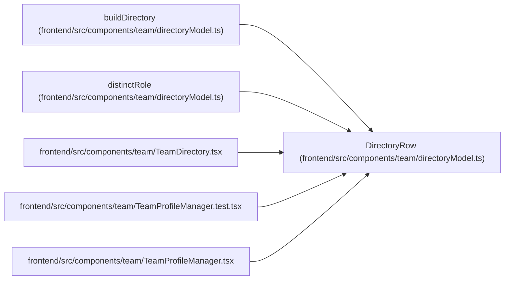

# DirectoryRow

**Location:** `frontend/src/components/team/directoryModel.ts:29`
**Kind:** Interface
**Bases:** —
**Module:** [directoryModel](../modules/directoryModel.md)

## Description

_Auto-generated from `DirectoryRow` in `frontend/src/components/team/directoryModel.ts`._

## Attributes

| Name | Type | Required | Default | Description |
|------|------|----------|---------|-------------|
| `key` | `string` | Yes | — | — |
| `kind` | `DirectoryKind` | Yes | — | — |
| `name` | `string` | Yes | — | — |
| `profile` | `TeamMemberProfile \| null` | Yes | — | — |
| `actors` | `DirectoryActor[]` | Yes | — | — |
| `roles` | `DirectoryRole[]` | Yes | — | — |
| `skills` | `TeamMemberProfileSkill[]` | Yes | — | — |
| `status` | `AgentStatus \| null` | Yes | — | — |
| `rosterState` | `RosterState` | Yes | — | — |

## Methods

*No declared methods.*

## Relationships

<!-- Auto-generated relationship summary. Do not edit by hand. -->

### Summary

| Module | Methods | Attributes |
|---|---:|---|
| [directoryModel](../modules/directoryModel.md) | 0 | `actors`, `key`, `kind`, `name`, `profile`, `roles`, `rosterState`, `skills`, `status` |

### References

| Reference | Kind | Source | Call sites |
|---|---|---|---:|
| `buildDirectory` | type_reference | [directoryModel](../modules/directoryModel.md) | — |
| `distinctRole` | type_reference | [directoryModel](../modules/directoryModel.md) | — |
| `TeamDirectory` | import | [TeamDirectory](../modules/TeamDirectory.md) | — |
| `TeamProfileManager.test` | import | [TeamProfileManager.test](../modules/TeamProfileManager.test.md) | — |
| `TeamProfileManager` | import | [TeamProfileManager](../modules/TeamProfileManager.md) | — |
