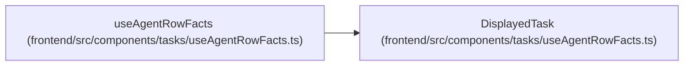

# DisplayedTask

**Location:** `frontend/src/components/tasks/useAgentRowFacts.ts:13`
**Kind:** Interface
**Bases:** —
**Module:** [useAgentRowFacts](../modules/useAgentRowFacts.md)

## Description

A row the page shows: only its id and status decide whether a Reviewer is read for it.

## Attributes

| Name | Type | Required | Default | Description |
|------|------|----------|---------|-------------|
| `id` | `number` | Yes | — | — |
| `status` | `TaskStatus` | Yes | — | — |

## Methods

*No declared methods.*

## Relationships

<!-- Auto-generated relationship summary. Do not edit by hand. -->

### Summary

| Module | Methods | Attributes |
|---|---:|---|
| [useAgentRowFacts](../modules/useAgentRowFacts.md) | 0 | `id`, `status` |

### References

| Reference | Kind | Source | Call sites |
|---|---|---|---:|
| `useAgentRowFacts` | type_reference | [useAgentRowFacts](../modules/useAgentRowFacts.md) | — |
