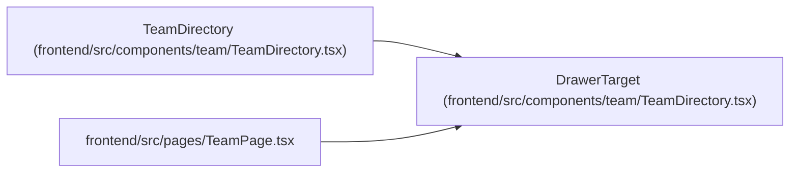

# DrawerTarget

**Location:** `frontend/src/components/team/TeamDirectory.tsx:44`
**Kind:** Type alias
**Bases:** —
**Module:** [TeamDirectory](../modules/TeamDirectory.md)
**Target:**

```typescript
{ mode: 'add' } | { mode: 'edit'; key: string } | null
```

## Description

_Auto-generated from `DrawerTarget` in `frontend/src/components/team/TeamDirectory.tsx`._

## Attributes

*See the alias definition for its member types.*

## Methods

*See the alias definition for callable and member types.*

## Relationships

<!-- Auto-generated relationship summary. Do not edit by hand. -->


### Summary

| Module | Methods | Attributes |
|---|---:|---|
| [TeamDirectory](../modules/TeamDirectory.md) | 0 | — |

### References

| Reference | Kind | Source | Call sites |
|---|---|---|---:|
| `TeamDirectory` | type_reference | [TeamDirectory](../modules/TeamDirectory.md) | — |
| `TeamPage` | import | [TeamPage](../modules/TeamPage.md) | — |
