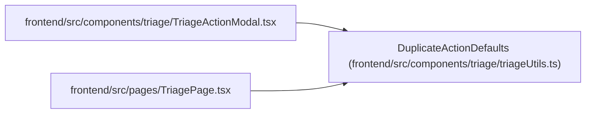

# DuplicateActionDefaults

**Location:** `frontend/src/components/triage/triageUtils.ts:140`
**Kind:** Interface
**Bases:** —
**Module:** [triageUtils](../modules/triageUtils.md)

## Description

_Auto-generated from `DuplicateActionDefaults` in `frontend/src/components/triage/triageUtils.ts`._

## Attributes

| Name | Type | Required | Default | Description |
|------|------|----------|---------|-------------|
| `targetType` | `'triage' \| 'task'` | Yes | — | — |
| `targetId` | `number` | Yes | — | — |
| `title` | `string` | Yes | — | — |
| `iterationId` | `number \| null` | No | — | — |

## Methods

*No declared methods.*

## Relationships

<!-- Auto-generated relationship summary. Do not edit by hand. -->

### Summary

| Module | Methods | Attributes |
|---|---:|---|
| [triageUtils](../modules/triageUtils.md) | 0 | `iterationId`, `targetId`, `targetType`, `title` |

### References

| Reference | Kind | Source | Call sites |
|---|---|---|---:|
| `TriageActionModal` | import | [TriageActionModal](../modules/TriageActionModal.md) | — |
| `TriagePage` | import | [TriagePage](../modules/TriagePage.md) | — |
