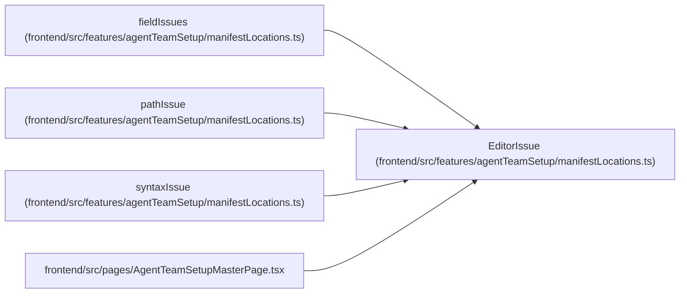

# EditorIssue

**Location:** `frontend/src/features/agentTeamSetup/manifestLocations.ts:6`
**Kind:** Interface
**Bases:** —
**Module:** [manifestLocations](../modules/manifestLocations.md)

## Description

Where things are in the manifest editor: the line of each JSON path, so a
problem can say "line 12" and the editor can jump there.

## Attributes

| Name | Type | Required | Default | Description |
|------|------|----------|---------|-------------|
| `line` | `number \| null` | Yes | — | — |
| `path` | `string \| null` | Yes | — | — |
| `message` | `string` | Yes | — | — |

## Methods

*No declared methods.*

## Relationships

<!-- Auto-generated relationship summary. Do not edit by hand. -->

### Summary

| Module | Methods | Attributes |
|---|---:|---|
| [manifestLocations](../modules/manifestLocations.md) | 0 | `line`, `message`, `path` |

### References

| Reference | Kind | Source | Call sites |
|---|---|---|---:|
| `fieldIssues` | type_reference | [manifestLocations](../modules/manifestLocations.md) | — |
| `pathIssue` | type_reference | [manifestLocations](../modules/manifestLocations.md) | — |
| `syntaxIssue` | type_reference | [manifestLocations](../modules/manifestLocations.md) | — |
| `AgentTeamSetupMasterPage` | import | [AgentTeamSetupMasterPage](../modules/AgentTeamSetupMasterPage.md) | — |
