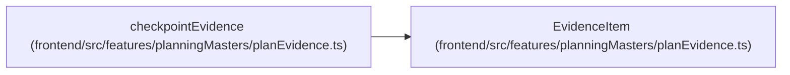

# EvidenceItem

**Location:** `frontend/src/features/planningMasters/planEvidence.ts:11`
**Kind:** Type alias
**Bases:** —
**Module:** [planEvidence](../modules/planEvidence.md)
**Target:**

```typescript
{
    label: string;
    value: string;
    /** An actionable exception: shown in the exception colour. */
    exception?: boolean;
    href?: string;
    actionLabel?: string;
}
```

## Description

_Auto-generated from `EvidenceItem` in `frontend/src/features/planningMasters/planEvidence.ts`._

## Attributes

*See the alias definition for its member types.*

## Methods

*See the alias definition for callable and member types.*

## Relationships

<!-- Auto-generated relationship summary. Do not edit by hand. -->


### Summary

| Module | Methods | Attributes |
|---|---:|---|
| [planEvidence](../modules/planEvidence.md) | 0 | — |

### References

| Reference | Kind | Source | Call sites |
|---|---|---|---:|
| `checkpointEvidence` | type_reference | [planEvidence](../modules/planEvidence.md) | — |
