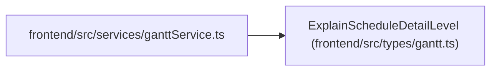

# ExplainScheduleDetailLevel

**Location:** `frontend/src/types/gantt.ts:110`
**Kind:** Type alias
**Bases:** —
**Module:** [types_gantt](../modules/types_gantt.md)
**Target:**

```typescript
'brief' | 'full'
```

## Description

_Auto-generated from `ExplainScheduleDetailLevel` in `frontend/src/types/gantt.ts`._

## Attributes

*See the alias definition for its member types.*

## Methods

*See the alias definition for callable and member types.*

## Relationships

<!-- Auto-generated relationship summary. Do not edit by hand. -->


### Summary

| Module | Methods | Attributes |
|---|---:|---|
| [types_gantt](../modules/types_gantt.md) | 0 | — |

### References

| Reference | Kind | Source | Call sites |
|---|---|---|---:|
| `ganttService` | import | [ganttService](../modules/ganttService.md) | — |
