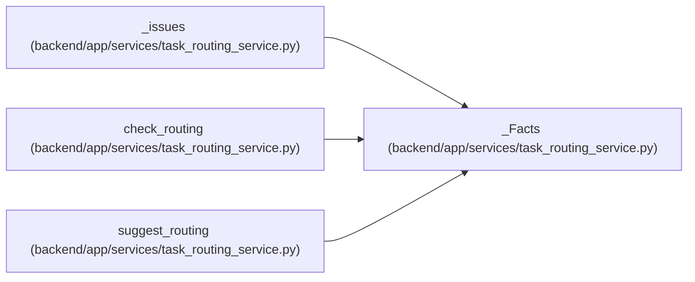

# _Facts

**Location:** `backend/app/services/task_routing_service.py:163`
**Kind:** Class
**Bases:** —
**Module:** [task_routing_service](../modules/task_routing_service.md)

**Decorators:** `@dataclass`

## Description

What a routing is checked against: the assignee, the policy and the live catalog.

## Attributes

| Name | Type | Default | Description |
|------|------|---------|-------------|
| `policy` | `bool` | *required* | — |
| `models` | `AssigneeModels` | *required* | — |
| `catalog` | `dict[str, AgentModelCatalogEntry]` | *required* | — |
| `verifiers` | `dict[str, list[int]]` | *required* | — |
| `contributor_publishers` | `set[str]` | `field(default_factory=set)` | — |
| `contributors_unknown` | `bool` | `False` | — |

## Methods

| Method | Signature | Decorators | Description |
|--------|-----------|------------|-------------|
| `verifier_profiles` | `(key)` | — | — |
| `executing` | `(first: RoutingRung \| None) -> set[str]` | — | Publishers the reviewer must differ from: the assignee's, the first rung's and every recorded contributor's. |

## Relationships

<!-- Auto-generated relationship summary. Do not edit by hand. -->

### Summary

| Module | Methods | Attributes |
|---|---:|---|
| [task_routing_service](../modules/task_routing_service.md) | 2 | `catalog`, `contributor_publishers`, `contributors_unknown`, `models`, `policy`, `verifiers` |

### References

| Reference | Kind | Source | Call sites |
|---|---|---|---:|
| `_issues` | type_reference | [task_routing_service](../modules/task_routing_service.md) | — |
| `check_routing` | call | [task_routing_service](../modules/task_routing_service.md) | 1 |
| `suggest_routing` | type_reference | [task_routing_service](../modules/task_routing_service.md) | — |
