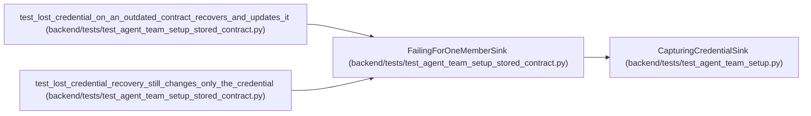

# FailingForOneMemberSink

**Location:** `backend/tests/test_agent_team_setup_stored_contract.py:123`
**Kind:** Class
**Bases:** `CapturingCredentialSink`
**Module:** [test_agent_team_setup_stored_contract](../modules/test_agent_team_setup_stored_contract.md)

## Description

Lose the first credential delivery for one chosen member.

## Attributes

*No annotated attributes found.*

## Methods

| Method | Signature | Decorators | Description |
|--------|-----------|------------|-------------|
| `__init__` | `(actor_key: str) -> None` | — | — |
| `deliver` | *(async)* `(*, credential_ref: str, actor_key: str, actor_name: str, api_key: str) -> str` | — | — |

## Relationships

<!-- Auto-generated relationship summary. Do not edit by hand. -->

### Summary

| Module | Methods | Attributes |
|---|---:|---|
| [test_agent_team_setup_stored_contract](../modules/test_agent_team_setup_stored_contract.md) | 2 | — |

### Structure

| Kind | Entity | Module |
|---|---|---|
| Base | `CapturingCredentialSink` | [test_agent_team_setup](../modules/test_agent_team_setup.md) |

### References

| Reference | Kind | Source | Call sites |
|---|---|---|---:|
| `test_lost_credential_on_an_outdated_contract_recovers_and_updates_it` | call | [test_agent_team_setup_stored_contract](../modules/test_agent_team_setup_stored_contract.md) | 1 |
| `test_lost_credential_recovery_still_changes_only_the_credential` | call | [test_agent_team_setup_stored_contract](../modules/test_agent_team_setup_stored_contract.md) | 1 |
