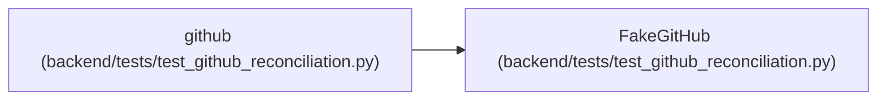

# FakeGitHub

**Location:** `backend/tests/test_github_reconciliation.py:28`
**Kind:** Class
**Bases:** —
**Module:** [test_github_reconciliation](../modules/test_github_reconciliation.md)

## Description

A mutable pull request behind a mock transport; records every request.

## Attributes

*No annotated attributes found.*

## Methods

| Method | Signature | Decorators | Description |
|--------|-----------|------------|-------------|
| `__init__` | `()` | — | — |
| `payload` | `(head, updated, *, number = 39, state = 'open', merged_at = None, draft = False)` | `@staticmethod` | — |
| `transport` | `()` | — | — |

## Relationships

<!-- Auto-generated relationship summary. Do not edit by hand. -->

### Summary

| Module | Methods | Attributes |
|---|---:|---|
| [test_github_reconciliation](../modules/test_github_reconciliation.md) | 3 | — |

### References

| Reference | Kind | Source | Call sites |
|---|---|---|---:|
| `github` | call | [test_github_reconciliation](../modules/test_github_reconciliation.md) | 1 |
