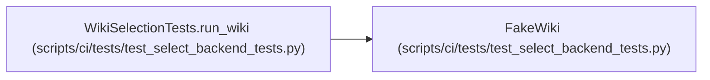

# FakeWiki

**Location:** `scripts/ci/tests/test_select_backend_tests.py:302`
**Kind:** Class
**Bases:** —
**Module:** [test_select_backend_tests](../modules/test_select_backend_tests.md)

## Description

Stands in for llm-wiki: impact and incoming imports from fixed data.

## Attributes

*No annotated attributes found.*

## Methods

| Method | Signature | Decorators | Description |
|--------|-----------|------------|-------------|
| `__init__` | `(impact: dict, imports: dict[str, dict]) -> None` | — | — |
| `impact_each` | `(paths)` | — | — |
| `incoming_imports` | `(locator)` | — | — |

## Relationships

<!-- Auto-generated relationship summary. Do not edit by hand. -->

### Summary

| Module | Methods | Attributes |
|---|---:|---|
| [test_select_backend_tests](../modules/test_select_backend_tests.md) | 3 | — |

### References

| Reference | Kind | Source | Call sites |
|---|---|---|---:|
| `WikiSelectionTests.run_wiki` | call | [test_select_backend_tests](../modules/test_select_backend_tests.md) | 1 |
