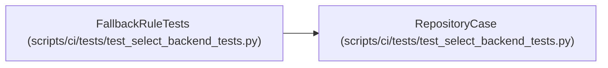

# FallbackRuleTests

**Location:** `scripts/ci/tests/test_select_backend_tests.py:102`
**Kind:** Class
**Bases:** `RepositoryCase`
**Module:** [test_select_backend_tests](../modules/test_select_backend_tests.md)

## Description

_Auto-generated from `FallbackRuleTests` in `scripts/ci/tests/test_select_backend_tests.py`._

## Attributes

*No annotated attributes found.*

## Methods

| Method | Signature | Decorators | Description |
|--------|-----------|------------|-------------|
| `assert_full` | `(files: dict[str, str], reason: str) -> None` | — | — |
| `test_conftest_anywhere_is_shared_ground` | `() -> None` | — | — |
| `test_nested_conftest_is_shared_ground` | `() -> None` | — | — |
| `test_migrations_models_and_configuration_are_shared_ground` | `() -> None` | — | — |
| `test_ordinary_paths_are_not_shared_ground` | `() -> None` | — | — |
| `test_missing_base_selects_full` | `() -> None` | — | — |
| `test_unknown_commit_selects_full` | `() -> None` | — | — |
| `test_test_data_change_selects_full` | `() -> None` | — | — |
| `test_unparseable_module_selects_full` | `() -> None` | — | — |
| `test_deleted_module_selects_full` | `() -> None` | — | — |
| `test_renamed_module_selects_full` | `() -> None` | — | — |
| `test_test_support_helper_is_shared_ground` | `() -> None` | — | — |
| `test_agent_skill_sources_and_build_script_are_shared_ground` | `() -> None` | — | — |
| `test_non_python_file_in_application_selects_full` | `() -> None` | — | — |
| `test_checkout_not_at_head_selects_full` | `() -> None` | — | — |
| `test_selection_covering_every_test_is_full` | `() -> None` | — | — |
| `test_full_mode_lists_only_existing_smoke_tests` | `() -> None` | — | — |

## Relationships

<!-- Auto-generated relationship summary. Do not edit by hand. -->

### Summary

| Module | Methods | Attributes |
|---|---:|---|
| [test_select_backend_tests](../modules/test_select_backend_tests.md) | 17 | — |

### Structure

| Kind | Entity | Module |
|---|---|---|
| Base | `RepositoryCase` | [test_select_backend_tests](../modules/test_select_backend_tests.md) |
