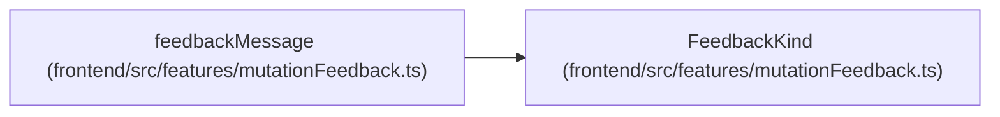

# FeedbackKind

**Location:** `frontend/src/features/mutationFeedback.ts:21`
**Kind:** Type alias
**Bases:** —
**Module:** [mutationFeedback](../modules/mutationFeedback.md)
**Target:**

```typescript
'project' | 'release' | 'milestone' | 'task' | 'triageItem' | 'teamMember' | 'profile' | 'initiative' | 'update' | 'absence'
```

## Description

_Auto-generated from `FeedbackKind` in `frontend/src/features/mutationFeedback.ts`._

## Attributes

*See the alias definition for its member types.*

## Methods

*See the alias definition for callable and member types.*

## Relationships

<!-- Auto-generated relationship summary. Do not edit by hand. -->


### Summary

| Module | Methods | Attributes |
|---|---:|---|
| [mutationFeedback](../modules/mutationFeedback.md) | 0 | — |

### References

| Reference | Kind | Source | Call sites |
|---|---|---|---:|
| `feedbackMessage` | type_reference | [mutationFeedback](../modules/mutationFeedback.md) | — |
