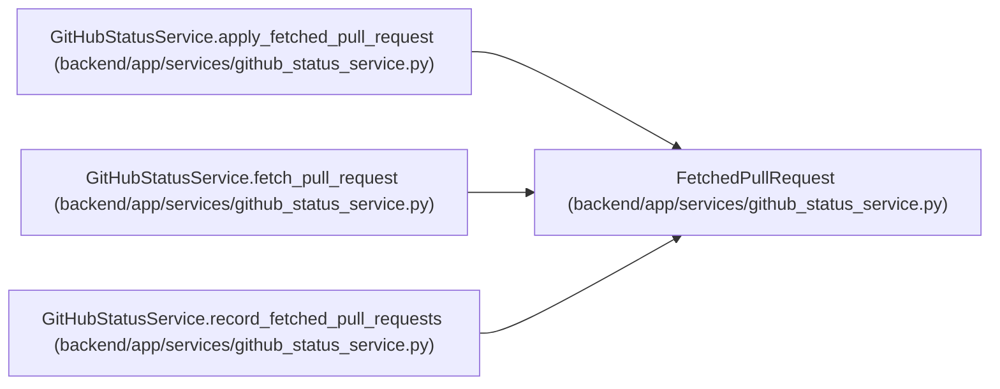

# FetchedPullRequest

**Location:** `backend/app/services/github_status_service.py:29`
**Kind:** Class
**Bases:** —
**Module:** [github_status_service](../modules/github_status_service.md)

**Decorators:** `@dataclass`

## Description

One pull request link as read from GitHub, before anything is locked or saved.

## Attributes

| Name | Type | Default | Description |
|------|------|---------|-------------|
| `link_id` | `int` | *required* | — |
| `owner` | `str` | *required* | — |
| `repo` | `str` | *required* | — |
| `number` | `int` | *required* | — |
| `refreshed_at` | `str` | *required* | — |
| `payload` | `Optional[dict[str, Any]]` | `None` | — |
| `observation` | `Optional[dict[str, Any]]` | `None` | — |
| `checks` | `Optional[dict[str, Any]]` | `None` | — |
| `error` | `Optional[Exception]` | `None` | — |

## Methods

*No declared methods.*

## Relationships

<!-- Auto-generated relationship summary. Do not edit by hand. -->

### Summary

| Module | Methods | Attributes |
|---|---:|---|
| [github_status_service](../modules/github_status_service.md) | 0 | `checks`, `error`, `link_id`, `number`, `observation`, `owner`, `payload`, `refreshed_at`, `repo` |

### References

| Reference | Kind | Source | Call sites |
|---|---|---|---:|
| `GitHubStatusService.apply_fetched_pull_request` | type_reference | [github_status_service](../modules/github_status_service.md) | — |
| `GitHubStatusService.fetch_pull_request` | call | [github_status_service](../modules/github_status_service.md) | 1 |
| `GitHubStatusService.fetch_pull_request` | type_reference | [github_status_service](../modules/github_status_service.md) | — |
| `GitHubStatusService.record_fetched_pull_requests` | type_reference | [github_status_service](../modules/github_status_service.md) | — |
