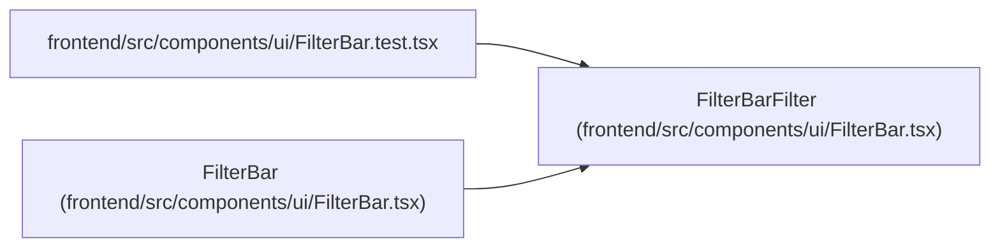

# FilterBarFilter

**Location:** `frontend/src/components/ui/FilterBar.tsx:12`
**Kind:** Type alias
**Bases:** —
**Module:** [FilterBar](../modules/FilterBar.md)
**Target:**

```typescript
{
    /** Stable key passed back to `onChange`. */
    id: string;
    /** Names the filter in its control, its chip and the remove button. */
    label: string;
    options: FilterBarOption[];
    /** The chosen option's value; an empty string means the filter is off. */
    value: string;
    /** `date` shows a date field instead of a list; the chip shows the matching option's label when there is one. */
    type?: 'select' | 'date';
    /**
     * A condition with no control of its own, shown only as its chip: one value of a filter that
     * holds several, or a condition another page handed over. Removing the chip sends `onChange(id, '')`.
     */
    chipOnly?: boolean;
}
```

## Description

_Auto-generated from `FilterBarFilter` in `frontend/src/components/ui/FilterBar.tsx`._

## Attributes

*See the alias definition for its member types.*

## Methods

*See the alias definition for callable and member types.*

## Relationships

<!-- Auto-generated relationship summary. Do not edit by hand. -->


### Summary

| Module | Methods | Attributes |
|---|---:|---|
| [FilterBar](../modules/FilterBar.md) | 0 | — |

### References

| Reference | Kind | Source | Call sites |
|---|---|---|---:|
| `FilterBar.test` | import | [FilterBar.test](../modules/FilterBar.test.md) | — |
| `FilterBar` | type_reference | [FilterBar](../modules/FilterBar.md) | — |
