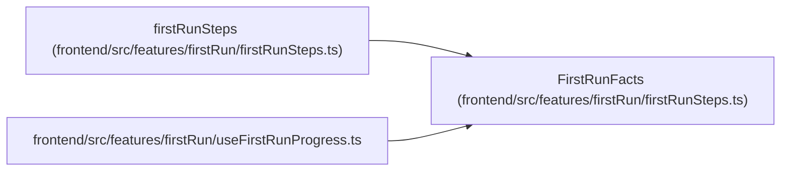

# FirstRunFacts

**Location:** `frontend/src/features/firstRun/firstRunSteps.ts:27`
**Kind:** Interface
**Bases:** —
**Module:** [firstRunSteps](../modules/firstRunSteps.md)

## Description

What the workspace holds, read from the server. Nothing here is a stored flag: every step
is done exactly while its data exists.

## Attributes

| Name | Type | Required | Default | Description |
|------|------|----------|---------|-------------|
| `profileChosen` | `boolean` | Yes | — | — |
| `projectCount` | `number` | Yes | — | — |
| `iterationCount` | `number` | Yes | — | — |
| `capacityRows` | `number` | Yes | — | — |
| `taskCount` | `number` | Yes | — | — |
| `scheduleApplied` | `boolean` | Yes | — | — |

## Methods

*No declared methods.*

## Relationships

<!-- Auto-generated relationship summary. Do not edit by hand. -->

### Summary

| Module | Methods | Attributes |
|---|---:|---|
| [firstRunSteps](../modules/firstRunSteps.md) | 0 | `capacityRows`, `iterationCount`, `profileChosen`, `projectCount`, `scheduleApplied`, `taskCount` |

### References

| Reference | Kind | Source | Call sites |
|---|---|---|---:|
| `firstRunSteps` | type_reference | [firstRunSteps](../modules/firstRunSteps.md) | — |
| `useFirstRunProgress` | import | [useFirstRunProgress](../modules/useFirstRunProgress.md) | — |
