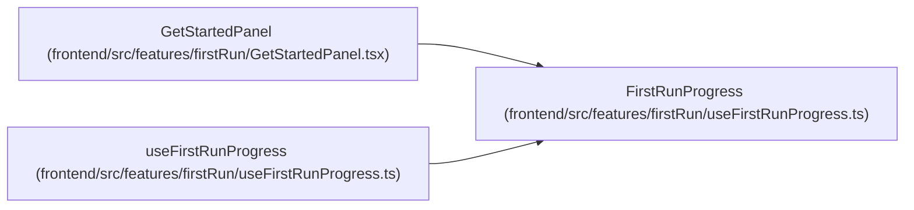

# FirstRunProgress

**Location:** `frontend/src/features/firstRun/useFirstRunProgress.ts:11`
**Kind:** Interface
**Bases:** —
**Module:** [useFirstRunProgress](../modules/useFirstRunProgress.md)

## Description

_Auto-generated from `FirstRunProgress` in `frontend/src/features/firstRun/useFirstRunProgress.ts`._

## Attributes

| Name | Type | Required | Default | Description |
|------|------|----------|---------|-------------|
| `known` | `boolean` | Yes | — | — |
| `applies` | `boolean` | Yes | — | — |
| `steps` | `FirstRunStep[]` | Yes | — | — |
| `nextId` | `FirstRunStepId \| null` | Yes | — | — |
| `complete` | `boolean` | Yes | — | — |
| `facts` | `FirstRunFacts` | Yes | — | — |
| `projectName` | `string \| null` | Yes | — | — |
| `plannedIteration` | `Iteration \| null` | Yes | — | — |

## Methods

*No declared methods.*

## Relationships

<!-- Auto-generated relationship summary. Do not edit by hand. -->

### Summary

| Module | Methods | Attributes |
|---|---:|---|
| [useFirstRunProgress](../modules/useFirstRunProgress.md) | 0 | `applies`, `complete`, `facts`, `known`, `nextId`, `plannedIteration`, `projectName`, `steps` |

### References

| Reference | Kind | Source | Call sites |
|---|---|---|---:|
| `GetStartedPanel` | type_reference | [GetStartedPanel](../modules/GetStartedPanel.md) | — |
| `useFirstRunProgress` | type_reference | [useFirstRunProgress](../modules/useFirstRunProgress.md) | — |
