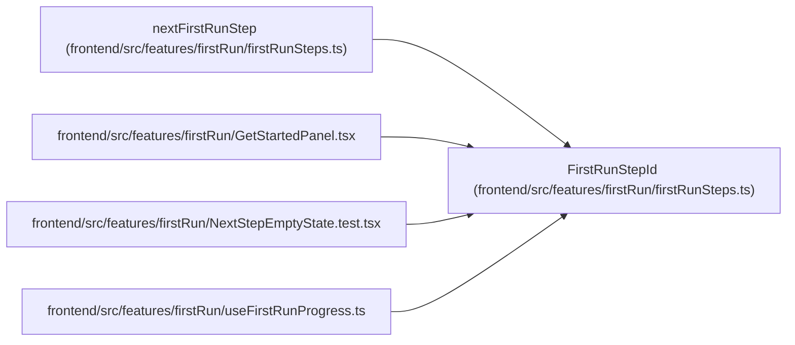

# FirstRunStepId

**Location:** `frontend/src/features/firstRun/firstRunSteps.ts:6`
**Kind:** Type alias
**Bases:** —
**Module:** [firstRunSteps](../modules/firstRunSteps.md)
**Target:**

```typescript
typeof FIRST_RUN_STEP_IDS[number]
```

## Description

_Auto-generated from `FirstRunStepId` in `frontend/src/features/firstRun/firstRunSteps.ts`._

## Attributes

*See the alias definition for its member types.*

## Methods

*See the alias definition for callable and member types.*

## Relationships

<!-- Auto-generated relationship summary. Do not edit by hand. -->


### Summary

| Module | Methods | Attributes |
|---|---:|---|
| [firstRunSteps](../modules/firstRunSteps.md) | 0 | — |

### References

| Reference | Kind | Source | Call sites |
|---|---|---|---:|
| `nextFirstRunStep` | type_reference | [firstRunSteps](../modules/firstRunSteps.md) | — |
| `GetStartedPanel` | import | [GetStartedPanel](../modules/GetStartedPanel.md) | — |
| `NextStepEmptyState.test` | import | [NextStepEmptyState.test](../modules/NextStepEmptyState.test.md) | — |
| `useFirstRunProgress` | import | [useFirstRunProgress](../modules/useFirstRunProgress.md) | — |
