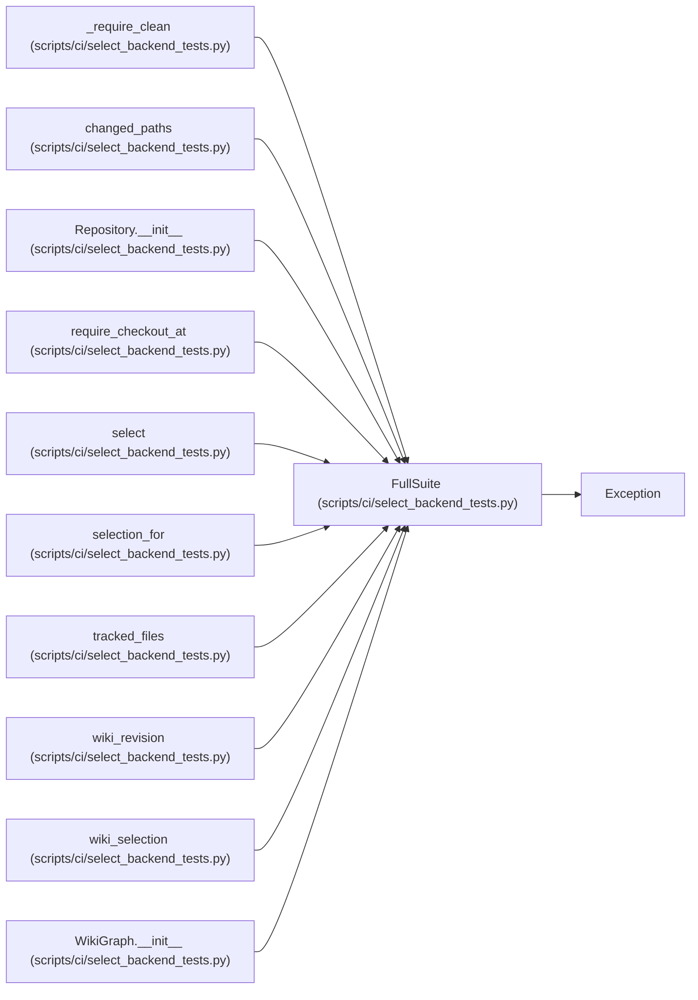

# FullSuite

**Location:** `scripts/ci/select_backend_tests.py:142`
**Kind:** Class
**Bases:** `Exception`
**Module:** [select_backend_tests](../modules/select_backend_tests.md)

## Description

Raised when the selection must fall back to the full suite.

## Attributes

*No annotated attributes found.*

## Methods

*No declared methods.*

## Relationships

<!-- Auto-generated relationship summary. Do not edit by hand. -->

### Summary

| Module | Methods | Attributes |
|---|---:|---|
| [select_backend_tests](../modules/select_backend_tests.md) | 0 | — |

### Structure

| Kind | Entity | Module |
|---|---|---|
| Base | `Exception` | — |

### References

| Reference | Kind | Source | Call sites |
|---|---|---|---:|
| `_require_clean` | call | [select_backend_tests](../modules/select_backend_tests.md) | 4 |
| `changed_paths` | call | [select_backend_tests](../modules/select_backend_tests.md) | 3 |
| `Repository.__init__` | call | [select_backend_tests](../modules/select_backend_tests.md) | 1 |
| `require_checkout_at` | call | [select_backend_tests](../modules/select_backend_tests.md) | 1 |
| `select` | call | [select_backend_tests](../modules/select_backend_tests.md) | 1 |
| `selection_for` | call | [select_backend_tests](../modules/select_backend_tests.md) | 3 |
| `tracked_files` | call | [select_backend_tests](../modules/select_backend_tests.md) | 1 |
| `wiki_revision` | call | [select_backend_tests](../modules/select_backend_tests.md) | 2 |
| `wiki_selection` | call | [select_backend_tests](../modules/select_backend_tests.md) | 3 |
| `WikiGraph.__init__` | call | [select_backend_tests](../modules/select_backend_tests.md) | 1 |
