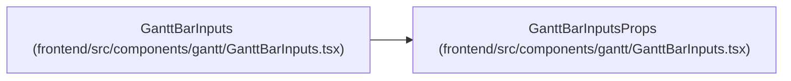

# GanttBarInputsProps

**Location:** `frontend/src/components/gantt/GanttBarInputs.tsx:17`
**Kind:** Interface
**Bases:** —
**Module:** [GanttBarInputs](../modules/GanttBarInputs.md)

## Description

_Auto-generated from `GanttBarInputsProps` in `frontend/src/components/gantt/GanttBarInputs.tsx`._

## Attributes

| Name | Type | Required | Default | Description |
|------|------|----------|---------|-------------|
| `task` | `GanttTask` | Yes | — | — |
| `iterationId` | `number` | Yes | — | — |
| `taskOptions` | `Array<{ id: number; title: string }>` | Yes | — | — |
| `anchor` | `{ top: number; left: number }` | Yes | — | — |
| `onApply` | `(changes: GanttBarInputChanges) => void` | Yes | — | — |
| `onMoreFields` | `() => void` | Yes | — | — |
| `onClose` | `() => void` | Yes | — | — |

## Methods

*No declared methods.*

## Relationships

<!-- Auto-generated relationship summary. Do not edit by hand. -->

### Summary

| Module | Methods | Attributes |
|---|---:|---|
| [GanttBarInputs](../modules/GanttBarInputs.md) | 0 | `anchor`, `iterationId`, `onApply`, `onClose`, `onMoreFields`, `task`, `taskOptions` |

### References

| Reference | Kind | Source | Call sites |
|---|---|---|---:|
| `GanttBarInputs` | type_reference | [GanttBarInputs](../modules/GanttBarInputs.md) | — |
