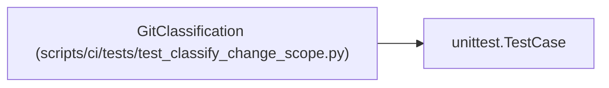

# GitClassification

**Location:** `scripts/ci/tests/test_classify_change_scope.py:54`
**Kind:** Class
**Bases:** `unittest.TestCase`
**Module:** [test_classify_change_scope](../modules/test_classify_change_scope.md)

## Description

_Auto-generated from `GitClassification` in `scripts/ci/tests/test_classify_change_scope.py`._

## Attributes

*No annotated attributes found.*

## Methods

| Method | Signature | Decorators | Description |
|--------|-----------|------------|-------------|
| `setUp` | `()` | — | — |
| `tearDown` | `()` | — | — |
| `_commit` | `(relative: str, text: str) -> str` | — | — |
| `_classify` | `(event: str, base: str, head: str) -> bool` | — | — |
| `test_docs_change_is_docs_only_for_pull_requests_and_pushes` | `()` | — | — |
| `test_code_change_runs_everything` | `()` | — | — |
| `test_unknown_event_or_base_runs_everything` | `()` | — | — |

## Relationships

<!-- Auto-generated relationship summary. Do not edit by hand. -->

### Summary

| Module | Methods | Attributes |
|---|---:|---|
| [test_classify_change_scope](../modules/test_classify_change_scope.md) | 7 | — |

### Structure

| Kind | Entity | Module |
|---|---|---|
| Base | `unittest.TestCase` | — |
