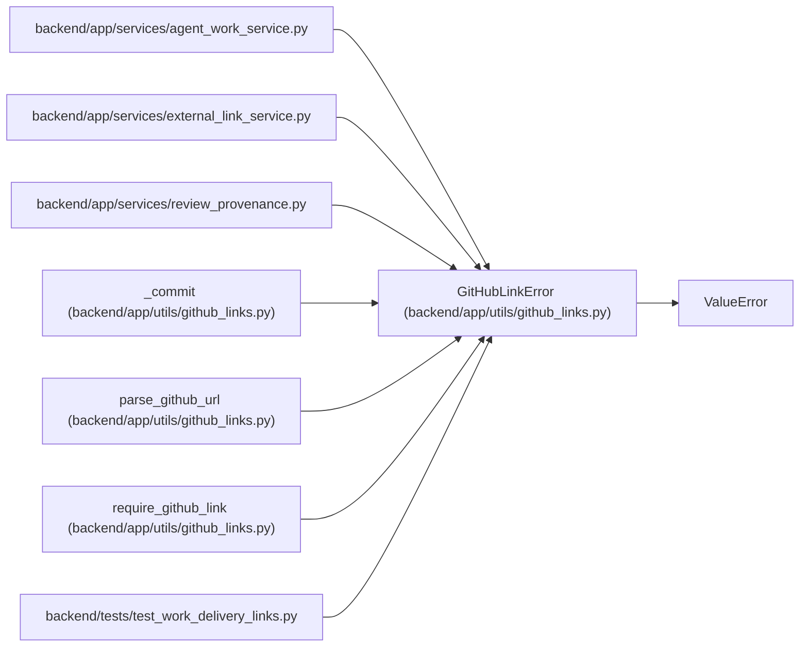

# GitHubLinkError

**Location:** `backend/app/utils/github_links.py:17`
**Kind:** Class
**Bases:** `ValueError`
**Module:** [github_links](../modules/github_links.md)

## Description

Raised when a URL is not a supported GitHub link.

## Attributes

*No annotated attributes found.*

## Methods

*No declared methods.*

## Relationships

<!-- Auto-generated relationship summary. Do not edit by hand. -->

### Summary

| Module | Methods | Attributes |
|---|---:|---|
| [github_links](../modules/github_links.md) | 0 | — |

### Structure

| Kind | Entity | Module |
|---|---|---|
| Base | `ValueError` | — |

### References

| Reference | Kind | Source | Call sites |
|---|---|---|---:|
| `agent_work_service` | import | [agent_work_service](../modules/agent_work_service.md) | — |
| `external_link_service` | import | [external_link_service](../modules/external_link_service.md) | — |
| `review_provenance` | import | [review_provenance](../modules/review_provenance.md) | — |
| `_commit` | call | [github_links](../modules/github_links.md) | 1 |
| `parse_github_url` | call | [github_links](../modules/github_links.md) | 4 |
| `require_github_link` | call | [github_links](../modules/github_links.md) | 1 |
| `test_work_delivery_links` | import | [test_work_delivery_links](../modules/test_work_delivery_links.md) | — |
